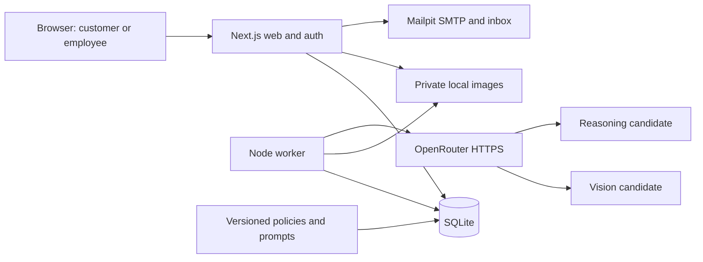
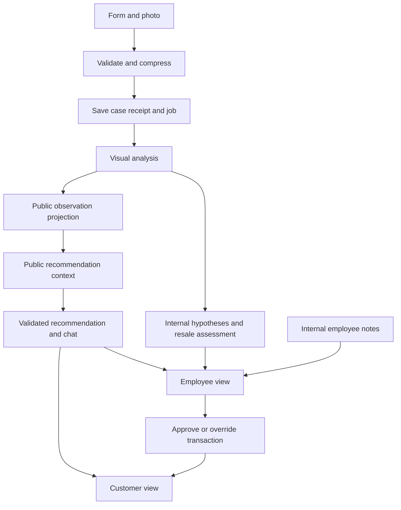
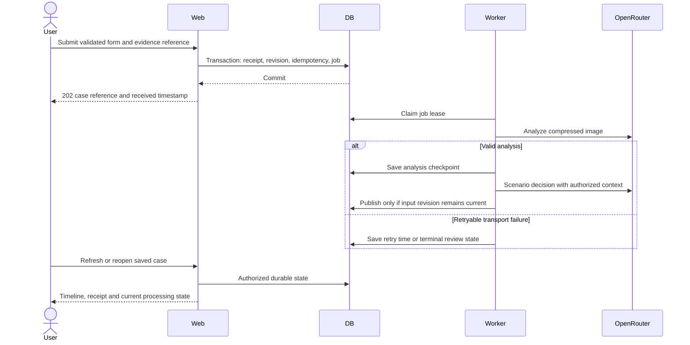
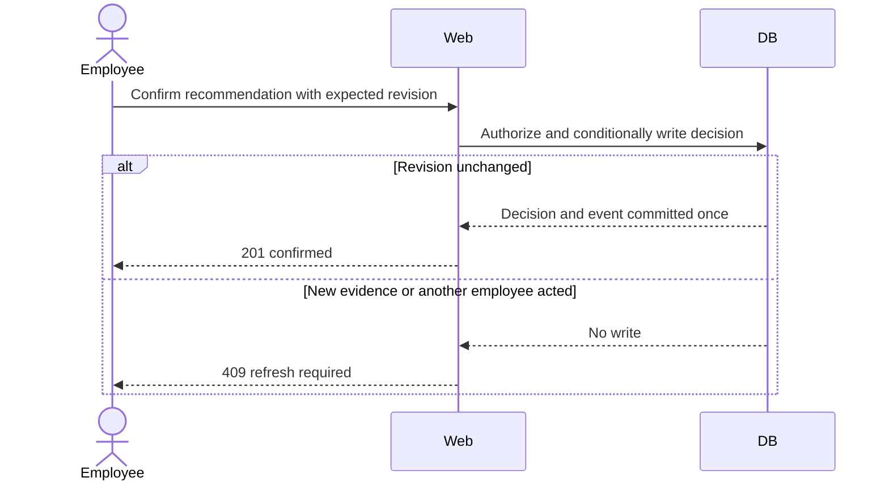

# ADR-000: Hardware Service Decision Copilot — Main Architecture

**Date:** 2026-10-18

**Status:** Accepted for local MVP; model candidates require live qualification

**PRD:** [Hardware Service Decision Copilot](../PRD.md)

## 1. Overview

Build a local web application for authenticated customers and company employees, with durable shared cases, two-stage image/decision processing and employee confirmation. Target the agreed pilot assumptions of 20 simultaneously active users and 100 new cases per day. These are design inputs, not demonstrated capacity.

User choices: no stack preference; local operation; recommend persistence and authentication; retain OpenRouter; recommend models. This ADR selects architecture, not production hosting. No application code or dependencies are installed by this documentation task.

| Record | Responsibility |
|---|---|
| [001 — Identity and privacy](001-identity-and-privacy.md) | Authentication, permissions, email and data boundaries |
| [002 — Cases and persistence](002-cases-persistence-and-api.md) | Entities, transactions, storage, lifecycle and API |
| [003 — AI processing](003-ai-and-image-processing.md) | Image compression, jobs, model contracts and recovery |
| [004 — Frontend and verification](004-frontend-and-verification.md) | UI state, accessibility and verification across layers |

## 2. Technology Documentation References

Official documentation checked on 2026-10-18. Context7 CLI 0.8.0 resolution attempts for Next.js, Better Auth and Drizzle failed with npm DNS error EAI_AGAIN. No callable Context7 MCP tools were available in this session. Official sources were used as the skill's fallback; no Context7 IDs were verified or invented.

| Technology | Official documentation | Used for |
|---|---|---|
| Node.js | [Release schedule](https://nodejs.org/en/about/previous-releases) | Runtime selection |
| Next.js | [Installation](https://nextjs.org/docs/app/getting-started/installation), [self-hosting](https://nextjs.org/docs/app/guides/self-hosting) | Web runtime |
| Better Auth | [Installation](https://better-auth.com/docs/installation) | Identity |
| SQLite | [WAL](https://www.sqlite.org/wal.html) | Local persistence constraints |
| OpenRouter | [Structured outputs](https://openrouter.ai/docs/guides/features/structured-outputs) | AI boundary |

## 3. System Architecture

### Pattern and technology stack

Use a modular monolith: one Next.js web process and one separate Node.js worker process from the same application package. Both access one SQLite database and one private local data directory. The worker owns durable AI jobs; no model call runs as a fire-and-forget task inside a request handler.

| Layer | Technology | Reason |
|---|---|---|
| Runtime | Node.js 24 LTS, npm | Supported LTS baseline and one package manager |
| Web/UI/API | Next.js 16 App Router, React, TypeScript | One origin and shared validation types |
| Styling | CSS Modules and global design tokens | No additional component framework required; visual design remains separate |
| Validation | Zod | Runtime validation for requests and model output |
| Persistence | SQLite, better-sqlite3, Drizzle ORM/Kit | Local database without a database service; explicit migrations |
| Identity | Better Auth with its stable Drizzle adapter | Maintained account/session lifecycle |
| Images | sharp | Server-side image decoding and transformation |
| Model transport | Native server-side fetch to OpenRouter Chat Completions | Small, explicit integration without an agent framework |
| Email | Nodemailer SMTP transport; local Mailpit | Real verification/recovery flow without sending external mail |
| Jobs | SQLite job table, one Node worker | Restart recovery without Redis |
| Verification | Vitest, React Testing Library, Playwright; Chrome DevTools manual QA | Repository-required TDD and real app validation |

Node 24 is listed as LTS in the referenced release table. Next.js supports running as a Node server; this decision uses the Node runtime rather than an edge runtime. Select compatible stable dependency releases within these baselines, pin exact versions in the implementation lockfile and record them in the app README. No beta/canary auth adapter, unverified package name or floating dependency may be used to resolve an integration mismatch. The Better Auth installation overview and dedicated adapter page differ: resolve against the chosen stable version's package exports during scaffolding.

### Proposed repository layout

| Location | Contents |
|---|---|
| app/src/app | Pages, layouts and thin HTTP route handlers |
| app/src/features | Form, chat, account and employee UI |
| app/src/domain | Case rules, statuses, permission policies and contracts |
| app/src/server | Application services, repositories, auth, file, email and LLM adapters |
| app/src/worker | Durable-job runner and cleanup tasks |
| app/drizzle | Reviewed database migrations |
| app/tests | Unit/integration, sanitized captures and real-stack E2E |
| app/scripts | Local startup, provisioning, backup and restore tools |
| docs/policies and docs/prompts | Versioned source policy and prompt artifacts |
| app/var | Gitignored database, private evidence and temporary data |

This layout is proposed; the application directory currently contains only a README. Keep existing course material and unrelated user changes untouched.

## 4. Modules and Dependencies

HTTP/UI adapters call application services. Services depend on pure domain rules and repository/transport interfaces. Infrastructure implements those interfaces. Worker uses the same services and domain rules, not the web endpoints. Browser bundles cannot import server repositories, credentials or model transport. No module imports the worker from the web layer.

| Module | Responsibility | Dependencies |
|---|---|---|
| Identity | Validate sessions and load current role | Better Auth, identity repository |
| Cases | Drafts, submission, timeline and employee actions | Domain, transactional repositories, permission guard |
| Evidence | Validate/compress/store/version images | sharp, private storage, case service |
| Processing | Build context and validate/publish recommendations | Policy snapshots, OpenRouter adapter, case repositories |
| Worker | Claim/retry jobs and coordinate processing | Processing, job repository |
| Presentation | Audience-specific case views and formatted messages | Explicit public/internal DTO contracts |

## 5. Data Models

The complete entity inventory is in [ADR-002](002-cases-persistence-and-api.md). Users own cases; cases have evidence, fact revisions, messages, policy snapshots, recommendations and employee actions. Jobs and idempotency records provide operational reliability. Identity tables follow the selected auth library's generated schema rather than a hand-built replacement.

## 6. Interface Contracts

All application HTTP endpoints are same-origin under `/api/v1`; Better Auth owns `/api/auth`. API requests authenticate and authorize before retrieving case contents. State-changing case requests carry an idempotency key and expected revision where specified. Long-running work returns a saved operation reference; clients poll durable state. Exact contracts and error semantics are in ADR-002; AI contracts are in ADR-003.

## 7. Environment Variables

These are proposed configuration requirements; this task does not change the existing `.env.example` or read secrets. Configuration must be validated at startup in web and worker processes.

| Variable | Purpose | Required | Non-secret example/default |
|---|---|---|---|
| APP_ENV | Local safety mode | Yes | local |
| APP_HOST / APP_PORT | Web bind | Yes | 127.0.0.1 / 3000 |
| BETTER_AUTH_URL | Canonical origin | Yes | http://localhost:3000 |
| BETTER_AUTH_SECRET | Session signing secret | Yes | Generated random secret, never committed |
| DATABASE_PATH | Shared absolute SQLite path | Yes | Absolute path ending app/var/copilot.sqlite |
| PRIVATE_DATA_DIR | Evidence and staging root | Yes | Absolute path ending app/var/private |
| OPENROUTER_API_KEY | Server-only model access | Yes for AI | Secret supplied locally |
| OPENROUTER_BASE_URL | Fixed gateway origin | Yes | https://openrouter.ai/api/v1 |
| VISION_MODEL | Image candidate | Yes | google/gemini-2.5-flash |
| DECISION_MODEL | Reasoning candidate | Yes | anthropic/claude-sonnet-4.5 |
| OPENROUTER_PROVIDER_ALLOWLIST | Explicit qualified provider slugs | Yes before model jobs run | Set after capability check; no invented default |
| AI_DAILY_BUDGET_USD | Admission limit for estimated model spend | Yes | 5.00 for synthetic local use |
| SMTP_HOST / SMTP_PORT | Mailpit SMTP | Yes | 127.0.0.1 / 1025 |
| SMTP_SECURE | SMTP encryption | Yes | false on loopback only |
| SMTP_USER / SMTP_PASSWORD | Future authenticated SMTP | No in local mode | Unset |
| EMAIL_FROM | Local message sender | Yes | copilot@example.test |
| COMPANY_CONTACT | Alternative intake contact | Yes | Local demo label; real value before real use |
| DATA_MODE | Restrict intended data use | Yes | synthetic |

Image limits, rate limits, session durations and worker timers are versioned application settings defined by these ADRs, not a collection of undocumented environment overrides. Reject non-loopback host binding in the accepted local configuration. This application still makes outbound HTTPS model requests; “local” does not mean offline.

## 8. Technical Decisions

### One application package with a separate durable worker

**Status:** Accepted. **Date:** 2026-10-18.

**Context:** Shared cases must recover after browser refresh and process interruption. AI requests can outlive HTTP requests.

**Decision:** Use one Next.js package, a separate worker and a SQLite-backed job queue. Keep network calls outside write transactions.

**Rejected alternatives:** Microservices add deployment and coordination overhead; request-bound model calls lose durable execution guarantees.

**Consequences:** (+) Small local setup and recoverable jobs. (-) Two processes must run and share local paths.

**Review trigger:** Public hosting, multiple application hosts, or sustained queue delay above 30 seconds in the pilot load experiment.

### SQLite and private local evidence

**Status:** Accepted. **Date:** 2026-10-18.

**Context:** The target is local development, with durable access from multiple accounts. No production database platform is required.

**Decision:** SQLite with WAL on one local disk; private filesystem evidence.

**Rejected alternatives:** Browser storage cannot implement shared access; PostgreSQL/object storage introduce services unnecessary for the accepted local target.

**Consequences:** (+) Few prerequisites. (-) One writer at a time and no network filesystem database.

**Review trigger:** Multiple hosts, production launch, database busy errors above 1% of writes in a five-minute load run, or need for independently scalable storage. Reassess PostgreSQL and private object storage then; migration is not assumed automatic.

### Explicit AI workflow rather than autonomous tools

**Status:** Accepted. **Date:** 2026-10-18.

**Context:** The system recommends decisions but cannot execute remedies or approve itself.

**Decision:** Fixed image-analysis and decision stages; structured output; no agent tools, browsing or RAG.

**Rejected alternatives:** An autonomous agent framework creates permissions and loop behavior this MVP does not need; a single vision/decision prompt obscures the evidence boundary.

**Consequences:** (+) Auditable stages and bounded work. (-) More contracts and explicit retry handling.

**Review trigger:** Approved RAG or external action requirements.

## 9. Diagrams

### Architecture

### Data flow and audience boundary

### Submission, failure and recovery

### Concurrent employee confirmation

## 10. Testing Strategy

Use specification-first TDD: write tests, demonstrate the expected failure, implement, then verify. Unit tests mock dependencies; integration tests use real database, filesystem, auth and local email with only the external LLM mocked. E2E uses the real stack including paid OpenRouter calls against synthetic cases. Real model tests need an explicitly configured key and budget; absence is reported as a missing prerequisite, never counted as a pass.

Before creating any endpoint/database mock, capture a fresh real authorized synthetic response/query as required by AGENTS.md. Record status, non-secret headers, complete body or result/schema, request and date; never capture credentials. The architecture's DTO descriptions are intended contracts, not observed upstream responses.

| Layer | Scope | Tools |
|---|---|---|
| Unit | Permissions, states, projection, validation and context contracts | Vitest |
| Integration | Real transactions, files, auth/email, worker races; LLM only mocked from capture | Vitest |
| E2E | Two customer accounts, employee, actual model flow and refresh | Playwright |
| Manual | Real form-to-chat, photo replacement and employee confirmation | Chrome DevTools CLI; screenshots |

Detailed scenarios and the PRD acceptance mapping are in ADR-004. Build, test execution, successful startup and manual QA are separate evidence. Documentation-only validation for this ADR task checks links, fences and consistency; application verification begins during implementation.

- TAC-000-01: A stopped/restarted worker resumes committed pending work without duplicating a published message.
- TAC-000-02: No request to OpenRouter or SMTP occurs inside a SQLite write transaction.
- TAC-000-03: Browser responses and bundles contain no server credentials or internal-only records.
- TAC-000-04: All 52 PRD acceptance criteria have assigned verification coverage before implementation is called complete.

## 11. Deferred Production Decisions

Production hosting, real retention schedules, processor agreements, company policy adoption, real contact routes, backups outside the local machine and operational ownership remain unapproved. This local design is not a production readiness claim. Model qualification and exact dependency pins are implementation prerequisites, not permission to deploy.
