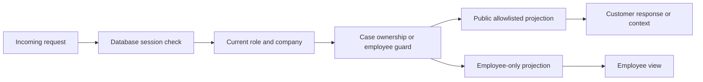
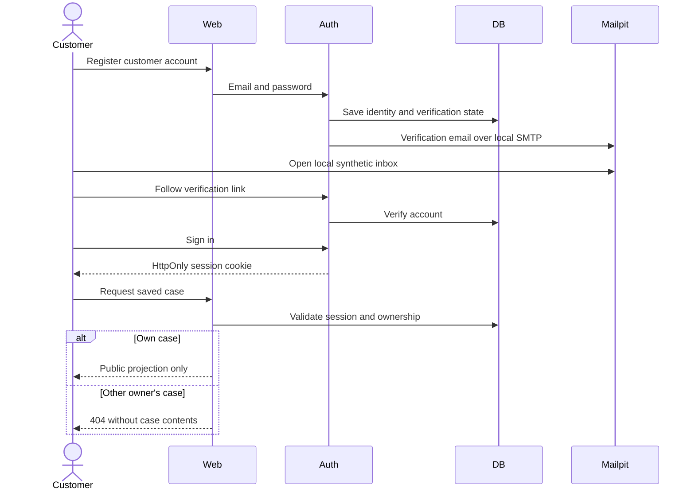

# ADR-001: Identity, Authorization and Privacy

**Date:** 2026-10-18

**Status:** Accepted for local MVP

**Relates to:** [Main architecture](000-main-architecture.md)

## 1. Scope

Account registration, verification, sign-in, recovery, employee provisioning, case authorization and customer/internal data separation. Case lifecycle is defined in ADR-002; model context assembly is in ADR-003.

## 2. Technology Documentation References

No verified Context7 IDs; see the lookup failure in ADR-000.

| Technology | Official documentation | Used for |
|---|---|---|
| Better Auth | [Email/password](https://better-auth.com/docs/authentication/email-password), [Next.js integration](https://better-auth.com/docs/integrations/next) | Account lifecycle |
| Better Auth | [Session management](https://better-auth.com/docs/concepts/session-management), [rate limits](https://better-auth.com/docs/concepts/rate-limit) | Session and abuse controls |
| Better Auth | [Stable Drizzle adapter](https://better-auth.com/docs/adapters/drizzle) | Identity persistence |
| Nodemailer | [SMTP](https://nodemailer.com/smtp) | Transport |
| Mailpit | [Configuration](https://mailpit.axllent.org/docs/configuration/) | Local email receipt |

## 3. Component Design

Use Better Auth's maintained email/password lifecycle and database-backed sessions, with email verification required. Use its hashing and token implementations; do not create parallel password/reset-token logic. Configure 12–128-character passwords, a 24-hour verification expiry, a one-hour password-reset expiry, a seven-day maximum session lifetime and revocation of existing sessions on password reset. Disable session cookie caching so permission-sensitive requests validate against current persisted state. Check exact supported configuration against the selected stable package during implementation.

Registration always creates a customer. Store employee permissions in an application-controlled membership record, not a writable registration field. An operator provisions or removes an employee using a local script that accepts a verified account identifier, requires explicit confirmation of the target and records the change. Never ship a default employee password or promote by email domain alone.

Every API, server-rendered page, evidence download and worker publish path applies authorization. This includes chat POST, stream GET/replay and cancellation from ADR-006; stream readers recheck current access before sending each batch. A stream run reference is not an access credential. UI visibility and route redirects are convenience controls, not authorization. Customers can access only their owned cases; employees can access cases in the single configured company. Return 404 for nonexistent and inaccessible case identifiers to avoid case enumeration. Unauthenticated requests return 401; attempts to use employee-only operations return 403 without case contents.

Use HttpOnly, SameSite=Lax session cookies. Secure cookies are required beyond HTTP loopback development. Verify Origin on state-changing application endpoints; accept only the configured canonical origin, no wildcard CORS. Keep auth library origin/CSRF protections enabled. No browser-local bearer token or password storage.

Rate limits are local product choices: sign-in five attempts per minute per IP and normalized email; registration/recovery/verification three per ten minutes per IP plus normalized email. General authenticated application requests: 120 per minute per actor; AI-triggering writes: ten per minute per actor; uploads: five per minute per actor. Persist limiter counters in SQLite for this topology. Return 429 with Retry-After. Do not trust arbitrary forwarded IP headers on the direct loopback server.

Mailpit captures actual SMTP messages locally on port 1025; inbox UI runs on 8025. Bind both to loopback. This exercises verification links without delivering external mail and does not establish real ownership of an external mailbox. UI and README must label the synthetic local account flow. A real deployment requires actual verified delivery and a separately reviewed SMTP/identity configuration.

## 4. Data Structures

| Structure | Fields and constraints |
|---|---|
| Auth identity/session/account/verification | Generated for the pinned Better Auth version; credentials never in case tables |
| Membership | User ID, single company ID, role customer or employee, enabled flag, updated UTC timestamp |
| Actor context | Server-derived user ID, verified state, current role/company; never accepted from request bodies |
| Public case view | Owner-visible form facts, active image reference, public messages, public recommendations, public employee decisions, public status |
| Internal case view | Public fields plus private notes, visual cause hypotheses, resale assessment, inspection records and operational job detail |
| Provisioning event | Target user ID, action, local operator identifier, timestamp; no password or token |

Public and internal DTOs use separate explicit allowlists. Do not serialize an internal model and remove a few known fields. Authorization happens before pagination, counts, filters and caching. Case responses use Cache-Control private, no-store. No case data goes to static generation, a shared cache, error telemetry payloads or application logs.

## 5. Interface Contracts

Better Auth owns `/api/auth`; use the pinned library's client methods for sign-up, verification, sign-in, session, sign-out, reset request and reset completion rather than inventing endpoint payloads. Adapt its results into Polish UI states; verify exact contracts during implementation using real synthetic captures.

| Boundary | Input | Output / failure |
|---|---|---|
| Session guard | Incoming cookie and headers | Current actor; 401 if absent, expired or revoked |
| Case access guard | Actor and case identifier | Authorized case scope; 404 for inaccessible/missing case |
| Employee guard | Actor | Enabled employee; otherwise 403 |
| Employee customer lookup | Exact normalized email, employee actor | Verified customer reference only; no purchase records; not available to customers |
| Email adapter | Library-produced recipient, subject and token link | Accepted local SMTP delivery or retryable failure; never log token links |
| Local provisioning | Verified account ID and requested role | Recorded membership update; reject unverified/unknown accounts |

Registration and reset request responses do not reveal whether another account exists. Tokens and passwords must be redacted from all request logs. Local email inbox is intentionally visible to the workstation operator and is not a customer-accessible feature.

## 6. Technical Decisions

### Library-managed identity with separate application roles

**Status:** Accepted. **Date:** 2026-10-18.

**Context:** The PRD requires shared customer/employee access and recovery, but no company identity platform was supplied.

**Decision:** Better Auth email/password sessions and application-owned role membership.

**Rejected alternatives:** Custom authentication duplicates security-sensitive lifecycle work; a managed identity platform adds an external account and deployment assumption to a local-only MVP.

**Consequences:** (+) Local identity persistence and clear role ownership. (-) SMTP capture and operational provisioning still need setup.

**Review trigger:** Company SSO, actual customer rollout or multi-company support.

### Separate internal storage and public context

**Status:** Accepted. **Date:** 2026-10-18.

**Context:** A customer must never see internal notes or damage hypotheses. Prompt instructions alone cannot enforce access control.

**Decision:** Separate data projections and context builders; customer generation never receives internal notes or internal analysis fields. An employee may explicitly publish a customer-facing inspection statement, creating a separate reviewed public fact.

**Rejected alternatives:** Hiding fields only in the UI still exposes API data; passing internal notes into the model and asking it to hide them creates an unnecessary disclosure path.

**Consequences:** (+) A structural privacy boundary. (-) Employee observations must be deliberately published before they can support a public explanation.

**Review trigger:** Any change to model context sources or audience contracts.

### Synthetic-only local data lifecycle

**Status:** Accepted. **Date:** 2026-10-18.

**Context:** Real retention/processor rules have not been supplied. Local model calls still send data externally.

**Decision:** Accepted mode is synthetic data. Include an explicit local dataset-reset operation; do not authorize an indefinite real-data retention default. Keep temporary originals for at most one hour and abandoned compressed uploads for at most 24 hours. Saved synthetic cases remain until explicit dataset reset; they are not an approved schedule for customer data.

**Rejected alternatives:** Inventing a production retention period could destroy required records; assuming local hosting prevents external disclosure is false.

**Consequences:** (+) Reproducible local work without an invented legal retention policy. (-) Real usage requires a new operational decision.

**Review trigger:** Any proposal to use real customer information.

## 7. Diagrams





### Password recovery

```mermaid
sequenceDiagram
    actor User
    participant Auth
    participant DB
    participant Mailpit
    User->>Auth: Request password reset
    Auth-->>User: Generic acknowledgment
    alt Existing account
        Auth->>Mailpit: Send local reset link
        User->>Auth: Submit valid token and new password
        Auth->>DB: Change credential and revoke sessions
        Auth-->>User: Reset complete; sign in again
    else Unknown account or invalid token
        Auth-->>User: No account disclosure; invalid link cannot reset
    end
```

## 8. Testing Strategy

TDD follows ADR-000 and repository rules. Integration uses real Better Auth, SQLite and Mailpit. No auth/email mocks in integration or E2E.

| Scenario | Type | Input | Expected result | Edge |
|---|---|---|---|---|
| Verification | Integration/E2E | New synthetic account | Verify link then sign-in succeeds | Expired/reused link |
| Recovery | Integration/E2E | Saved account reset | New password works, old sessions revoked | Unknown email indistinguishable |
| Ownership | Integration/E2E | Customer B requests A's IDs | 404 across detail, timeline and image | Pagination/count leakage |
| Privilege escalation | Integration | Customer sends employee role/body | No privilege change | Disabled employee session |
| Context isolation | Unit/integration | Internal notes contain unique sentinel | Sentinel absent from public DTO and model request | Nested/old messages |
| Origin/rate controls | Integration | Foreign Origin or repeated attempts | Rejection/429 without mutation | Parallel attempts |

- TAC-001-01: Customers cannot access another owner's records through any case-related endpoint.
- TAC-001-02: Public model requests and responses contain zero internal sentinel values from the isolation fixture.
- TAC-001-03: Removing employee membership takes effect on the next authenticated operation without waiting for cookie expiry.
- TAC-001-04: Sign-out/reset invalidates the applicable persisted sessions; tokens do not appear in logs.
