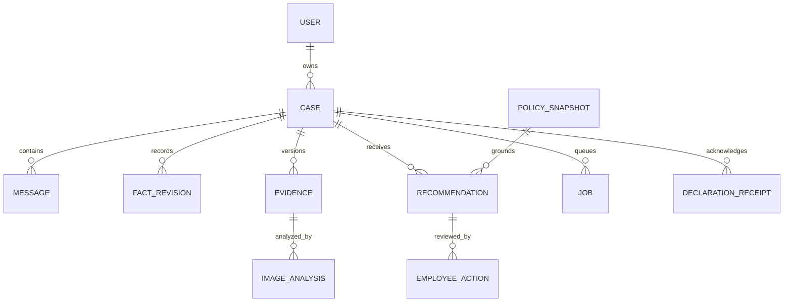
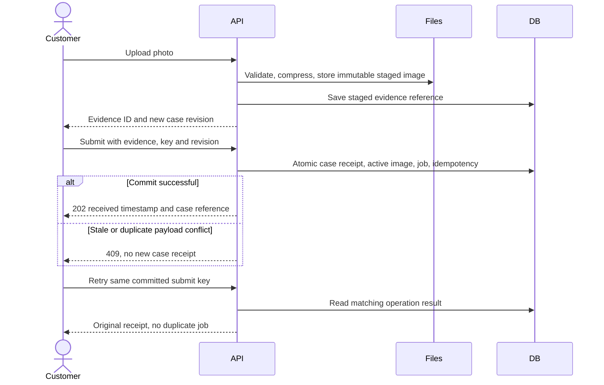

# ADR-002: Cases, Persistence and API Contracts

**Date:** 2026-10-18

**Status:** Accepted for local MVP

**Relates to:** [Main architecture](000-main-architecture.md)

## 1. Scope

Current transport extension: [ADR-006](006-streaming-and-decision-flow.md) adds chat SSE, replay and cancellation using the same case transactions. The JSON API below remains the domain baseline; it does not imply that DefaultChatTransport accepts a JSON 202 response.

Durable cases, evidence metadata, revision history, policy snapshots, transactional jobs, public/internal timelines and application HTTP contracts. Identity is defined in ADR-001; image/model execution is in ADR-003.

## 2. Technology Documentation References

No verified Context7 IDs; official references checked on 2026-10-18.

| Technology | Official documentation | Used for |
|---|---|---|
| Drizzle | [SQLite setup](https://orm.drizzle.team/docs/sqlite/get-started-sqlite), [transactions](https://orm.drizzle.team/docs/transactions) | Repositories and migrations |
| SQLite | [WAL](https://www.sqlite.org/wal.html), [online backup](https://www.sqlite.org/backup.html) | Concurrency and recovery |
| Zod | [Documentation](https://zod.dev/) | Request/response validation |

## 3. Component Design

### Persistence and transactions

Use better-sqlite3 through Drizzle. Enable foreign keys on every connection, WAL, synchronous FULL and a five-second busy timeout. One disk hosts the web and worker database connections; do not put the SQLite database on a network filesystem. Keep write transactions short. WAL supports concurrent reading with writing, but it does not allow multiple simultaneous writers.

Use migrations committed alongside implementation. Apply migrations once before starting web/worker, never independently from both processes. No destructive schema auto-sync on startup. Queries use parameter binding and case ownership constraints. Business receipts/decisions require committed records, not a browser cache.

For each mutation, atomically save the case change, timeline event, idempotency result and any required job. Employee confirmation additionally checks the expected revision and referenced recommendation. Use conditional updates; zero changed rows means 409 and no partial action. Sequence numbers allocated in the same transaction order timeline records unambiguously.

No network request or file compression belongs inside a write transaction. Prepare the private file first, then commit its immutable metadata; delete unreferenced prepared files during cleanup. If DB commit fails, the file stays unreferenced and must not be served as case evidence.

### State and concurrency

Keep operational processing state separate from business state:

| Dimension | Values |
|---|---|
| Business status | draft, awaiting_ai, needs_information, awaiting_employee, inspection_pending, confirmed, reassessment_pending |
| Processing status | idle, queued, image_analysis, recommendation, delayed, retry_scheduled, failed, complete |

`caseRevision` increases for every case mutation, including job publication and internal notes. `inputRevision` increases when public facts, customer/public employee chat, active photo, policy pin or employee outcome change. Internal notes do not enter public reasoning context. Public inspection findings are separate, explicitly published facts and increase inputRevision.

A submitted case starts awaiting_ai. A valid AI NEED_INFORMATION result moves it to needs_information; other completed recommendations enter awaiting_employee. HUMAN_REVIEW, explicit review requests or unresolved questions enter awaiting_employee with an escalation reason. An employee can mark inspection_pending, ask a public clarification or record a confirmed outcome. Accepted, alternative_proposed and declined are confirmed outcomes; escalated is an action leading to inspection_pending, not a final determination.

New public evidence after confirmation preserves the outcome and sets reassessment_pending. A model cannot restore confirmed status. Approval is enabled only for a current RECOMMEND_ACCEPT, RECOMMEND_ALTERNATIVE or RECOMMEND_DECLINE recommendation. NEED_INFORMATION and HUMAN_REVIEW cannot be approved as a final remedy; an employee must request facts, escalate or override with a complete independent rationale.

A public employee clarification creates a public message and moves the case to needs_information; no model call is needed until the customer replies. A private note never creates a customer-facing assistant response.

Only a worker result whose inputRevision and evidence/policy references still match can become current. A stale result is retained as superseded operational history and never posted as the current public message. An employee decision also increments inputRevision, invalidating any outstanding AI job. Later chat about that decision uses a newly captured context including the outcome.

### Drafts, uploads and receipts

Draft creation saves the customer owner, creator and case type. Autosave changes only draft fields; submitting locks case type and original form snapshot. Later corrections are typed fact revisions through chat confirmation; they do not rewrite that snapshot.

An upload endpoint stages one decoded/compressed image linked to the case. Draft-photo staging does not mark it submitted. Submit references the prepared evidence and atomically attaches it as version 1, saves the received timestamp and queues processing. Subsequent message submissions can attach one staged replacement. Each replacement gets a new evidence version; all previous saved compressed images remain available to authorized participants.

If the user explicitly declares withdrawal in the form or later in chat, require a separate confirmation control showing the declaration text. Save its receipt event and timestamp in the same transaction as the user's confirmation. A model suggestion or extracted sentence never alone creates a legal declaration event. Preserve timestamp if inference fails.

Drafts and unsent browser values are different: only successful autosave is durable. A not-yet-uploaded local File cannot survive refresh; the UI tells the user to reselect it. Uploaded draft evidence references are durable until submitted, replaced or the draft is deleted. Temporary files not referenced by an active draft expire after 24 hours.

## 4. Data Structures

All entity IDs are opaque UUIDs; timestamps are UTC instants displayed in Europe/Warsaw. Purchase/delivery/onset dates are date-only ISO values with source and precision (exact, approximate, unknown). Never convert a date-only fact by applying a timezone offset. Case reference is human-readable, unique and not a credential.

| Entity | Key conceptual fields | Relationships and constraints |
|---|---|---|
| Identity and membership | Auth-generated IDs; role/company/enabled | See ADR-001 |
| Case | ID/reference; owner/creator/company IDs; type complaint/return; statuses; model/category; purchase date/precision; original reason; receivedAt; caseRevision/inputRevision; active evidence and recommendation IDs | Owner is verified; incomplete draft form fields may be null; type immutable after submit |
| FactRevision | ID; case ID; fact key; typed value; source message/actor; confirmedAt; prior revision | Whitelisted keys: channel, delivery date, fault onset, remedy, prior attempts, purchase proof, withdrawal intention/date, relevant exception facts, product/model corrections |
| Evidence | ID; case ID; version; random private path; content hash; media type/dimensions/bytes; createdBy/at; status staged/attached | One initial attached image; monotonically numbered replacements |
| ImageAnalysis | ID; evidence ID; run ID; scenario; public observations; internal damage hypotheses/resale limitations; suitability; prompt/model IDs | Immutable per successful analysis run |
| PolicySnapshot | ID; scenario; policy version; exact text; SHA-256; clause IDs; approval marker; capturedAt | Immutable; case pins snapshot before AI execution |
| PromptSnapshot | ID/version/hash; scenario/stage; text | Referenced by each run |
| Message | ID; case ID; sequence; actor; audience public/internal; kind user/assistant/employee/system; text/structured content; evidence/recommendation ref | Immutable after save; public and internal never inferred from free text |
| Recommendation | ID; case ID; version; inputRevision; evidence/analysis/policy IDs; category; public rationale/clauses/questions/next steps; changed facts; current/superseded | Immutable; current only if revision checks pass |
| EmployeeAction | ID; case ID; actor/time; action; outcome; source recommendation; expected revision; internal rationale; public explanation | Append-only outside an explicit authorized data-deletion process |
| DeclarationReceipt | ID; case ID; customer/acting employee ID; declaration text; confirmation source; receivedAt | Never created by LLM output alone |
| StreamRun/StreamEvent | Public run identity, attempt, ordered safe progress/draft/canonical payloads and terminal state | Bounded replay storage and expiry per ADR-006; not canonical conversation history |
| Job/ModelRun | ID; case/input revision; stage; status; lease token/expiry; attempts; nextRunAt; input hash; model/provider; usage/cost; error code | See ADR-003; no raw reasoning traces |
| IdempotencyRecord | Actor + route + key; canonical payload hash; committed status/result ref; createdAt | Unique actor/route/key; retain for lifetime of synthetic case |
| ClarificationIssue | Case ID; stable allowed fact key; asked-at message; unsuccessful round count; resolved flag | Application counts rounds, model does not control counters |
| Operational controls | Rate-limit counters; budget reservations; employee provisioning events | Atomic updates; operational records contain no unnecessary case text |

Store text/structured values with schema version and validate on write/read. Enforce foreign keys and uniqueness for case evidence version, timeline sequence, recommendation version and idempotency key. Index owner/company plus updatedAt, queue status, job due time and case sequence. No customer purchase-history table is introduced.

Policy snapshots are copied from versioned documents, not read live on every chat turn. Local synthetic mode allows sample policies with a visible label. Real-data mode is outside the accepted scope and must not silently treat sample procedures as approved.

### File retention, reset and backup

Keep compressed evidence only; original uploads are temporary and removed after transformation or within one hour on crash recovery. Record the original input hash and transformation settings, not the original metadata. These compressed photos are assistance evidence, not forensic originals; revisiting retention is required if forensic use is added.

Provide local backup/restore scripts during implementation. For a consistent backup, stop accepting writes, drain/stop worker and web, use SQLite's backup mechanism and copy all referenced immutable evidence into one manifest-bearing snapshot. Do not copy only the live main database file while WAL writes continue. Restore into a new empty directory, verify database integrity and every evidence hash, then start processes. A backup on the same disk is a recovery artifact, not disaster recovery.

Dataset reset is explicit, confirms the target path, stops both processes and deletes only the configured local synthetic dataset and local email capture. Never use a path derived from user-upload filenames. No production retention schedule is implied.

## 5. Interface Contracts

### Common conventions

Same-origin JSON except multipart uploads and the explicit AI SDK UI SSE endpoints in ADR-006. IDs are UUID strings, dates ISO date-only, timestamps ISO UTC. Responses use explicit DTOs, never ORM objects. Reads use no-store. Lists are cursor-paginated, default 25 and maximum 100; timeline pages default 50 and maximum 100. Authorized full history is reconstructed server-side for model context independently of client pagination.

Mutation requests carry `Idempotency-Key` (UUID) and `expectedCaseRevision` when changing an existing case. Check for a previously committed idempotency result before rejecting an old expected revision, so a valid replay still returns its original result. First successful create returns 201, accepted processing returns 202, other saved mutations return 200 or 201. Duplicate same-key/same-payload operations return the original committed result; same key with another payload returns 409. If the first operation is still uncommitted, return 409 operation_in_progress and Retry-After. File upload hash covers metadata plus content, not multipart boundary bytes.

Errors: 400 malformed request; 401 missing session; 403 disallowed employee action/origin; 404 inaccessible/missing resource; 409 stale revision/idempotency conflict; 413 size/pixel limit; 415 unsupported content; 422 invalid fields or illegal transition; 429 rate limit; 503 temporary database/dependency failure. Error body contains stable code, Polish safe message, optional field errors, retryable flag and request reference. No stack trace, provider body or case contents in errors.

| Endpoint | Input and authorization | Success output | Additional failures/notes |
|---|---|---|---|
| GET /api/v1/me | Session | ID, role/company, verified state | 401 |
| GET /api/v1/customers/lookup | Employee; exact email | Verified customer ID and display label, or empty result | 403; no broad customer search |
| GET /api/v1/cases | Session; cursor/status filters | Scoped summaries, next cursor | Scope applied before count/filter |
| POST /api/v1/cases | Type; employee may supply verified owner ID | Draft ID/reference/revisions | Customer owner always server-derived |
| GET /api/v1/cases/{id} | Case authorization | Public detail plus revisions/current operations; explicit internal fields only for employee | 404 |
| PATCH /api/v1/cases/{id}/draft | Expected revision; allowed draft fields | Saved draft and revision | 409/422 after submission |
| POST /api/v1/cases/{id}/uploads | Multipart file; stage draft or replacement; expected revision | Prepared evidence ID, preview route, metadata and revision | 413/415/422; does not itself submit or activate replacement |
| GET /api/v1/cases/{id}/evidence/{evidenceId} | Case authorization; evidence must belong to case | Compressed image bytes; private no-store, nosniff | 404; never serves a requested arbitrary path |
| POST /api/v1/cases/{id}/submit | Expected revision, staged evidence ID, complete form; return intention advice/withdraw_now | Case receipt, receivedAt, job ID, current revision | 422 missing required data; withdrawal confirmation handled separately |
| GET /api/v1/cases/{id}/timeline | Cursor; authorized audience | Ordered audience-filtered messages/events, next cursor | No internal counts leaked |
| POST /api/v1/cases/{id}/messages | Text up to 5,000 characters and/or one staged replacement ID; expected revision | Saved message, new revision and queued job if needed | JSON alternative to the /chat transport; both call one service and share domain idempotency |
| POST /api/v1/cases/{id}/facts/confirm | Allowed typed fact patch, source message ID, expected revision | Saved fact revisions, new input revision and reassessment job | Cannot set actor, policy, role or outcome |
| POST /api/v1/cases/{id}/declarations | Explicit declaration text/confirmation and expected revision | Saved withdrawal receipt/time, new input revision and reassessment job | Chat extraction alone insufficient |
| POST /api/v1/cases/{id}/review-request | Public reason, expected revision | Employee queue state | No AI call required |
| POST /api/v1/cases/{id}/processing/retry | Failed job ID, expected revision | Reused checkpoint/new operation ID | 422 if no eligible failed stage; recheck budget |
| POST /api/v1/cases/{id}/internal-notes | Employee; text 1–5,000 characters, expected revision | Internal note and revision | Does not enqueue public AI |
| POST /api/v1/cases/{id}/inspection-findings | Employee; internal text, optional explicitly reviewed public statement; expected revision | Saved finding; new public input revision/job only if public statement supplied | Internal text never auto-published |
| POST /api/v1/cases/{id}/employee-actions | Employee; approve/override/clarify/escalate; source recommendation where applicable; expected revision; outcome/rationale/explanation | Saved action, public event, new revisions and status | 409 stale; override requires nonblank internal rationale and public explanation, each max 5,000 characters |
| POST /api/v1/cases/{id}/links | Employee; related case ID, reason, expected revision | Case link visible to authorized viewers | Same owner/company only; no type mutation |
| POST /api/v1/cases/{id}/chat | Latest user input, evidence reference, revision and key | 200 AI SDK UI SSE after durable acceptance | See ADR-006; not 202 JSON |
| GET /api/v1/cases/{id}/chat/stream | Authorized case and optional run reference | Active replay/live SSE or 204 | No job creation; see ADR-006 |
| POST /api/v1/cases/{id}/chat/runs/{runId}/cancel | Revision and idempotency key | Saved cancellation or already_complete | Explicit worker cancellation; see ADR-006 |
| GET /api/v1/health | Loopback health caller | Liveness; readiness summary for DB/worker/config | No credentials or case data |

Facts proposed by the model remain proposals until confirmed by the user/employee. Messages still remain in full context, but ambiguous dates do not become verified deadline facts automatically. A confirmed fact can be corrected only through a new fact revision.

## 6. Technical Decisions

### Durable writes with explicit idempotency and revision checks

**Status:** Accepted. **Date:** 2026-10-18.

**Context:** Refresh/retry and concurrent employee decisions can duplicate or overwrite outcomes.

**Decision:** Use atomic domain writes, event records, jobs and idempotency results; optimistic concurrency on case revisions.

**Rejected alternatives:** Last-write-wins loses employee decisions; UI-only disabled buttons do not prevent replay.

**Consequences:** (+) Deterministic state changes. (-) Clients must recover from 409 and reuse retry keys correctly.

**Review trigger:** Distributed deployment or external transaction side effects.

### Immutable evidence and policy versions

**Status:** Accepted. **Date:** 2026-10-18.

**Context:** Replacing photos or updating policy must not rewrite the explanation of an earlier decision.

**Decision:** Append versions and pin all analysis/recommendation references. Policy migration is an explicit employee/operator-triggered reassessment.

**Rejected alternatives:** Overwriting the active image or reading current policy text on every turn makes history irreproducible.

**Consequences:** (+) Reviewable decision history. (-) More storage and explicit data-deletion planning.

**Review trigger:** Real-data retention requirements or evidence volume exceeding local capacity.

## 7. Diagrams

## 8. Testing Strategy

Unit tests exercise state rules with mocked repository interfaces. Integration uses an actual temporary SQLite file in WAL mode and private filesystem. Derive any query mocks from fresh sanitized captures under repository rules.

| Scenario | Type | Input | Expected output | Edge cases |
|---|---|---|---|---|
| Atomic receipt | Integration | Valid submitted draft | Receipt/job/event committed together | DB failure leaves no partial receipt |
| Replay | Integration | Parallel identical keys | One logical operation | Different payload same key conflicts |
| Concurrent decisions | Integration | Two employees, same revision | One decision succeeds | New photo invalidates both old forms |
| Superseded model result | Integration | New public fact while model runs | Old result not current or published | Employee confirmation during call |
| Evidence path | Integration | Traversal filename/cross-case evidence ID | No file disclosure | Decodable spoofed type |
| Backup restore | Integration | Synthetic case with history/files | Restored records and image hashes match | Missing evidence blocks successful restore |
| Declaration | Integration/E2E | Explicit confirmation then AI outage | Timestamp persists | Advice-only request has no receipt |

- TAC-002-01: A failed transactional save creates no success receipt, timeline event or pending job for that operation.
- TAC-002-02: Replaying a committed idempotency key creates zero additional messages/actions/jobs.
- TAC-002-03: Of two approval attempts using the same revision, at most one succeeds.
- TAC-002-04: All saved recommendations reference existing immutable policy, input and evidence versions.
- TAC-002-05: The restore check detects a missing or mismatched evidence file rather than declaring success.
