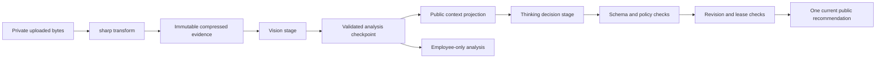

# ADR-003: AI, Image Processing and Durable Jobs

**Date:** 2026-10-18

**Status:** Accepted architecture; model candidates subject to live qualification

**Relates to:** [Main architecture](000-main-architecture.md)

## 1. Scope

Backend compression, distinct complaint/return visual analysis and decision prompts, full authorized conversation context, structured results, durable execution, retries and cost controls. The model has no application action tools, RAG or purchase-history access.

## 2. Technology Documentation References

Official sources checked on 2026-10-18; no Context7 ID was verified.

| Technology | Official documentation | Used for |
|---|---|---|
| sharp | [Constructor](https://sharp.pixelplumbing.com/api-constructor/), [operations](https://sharp.pixelplumbing.com/api-operation/), [output](https://sharp.pixelplumbing.com/api-output/) | Pixel limits, orientation and metadata removal |
| OpenRouter | [Image input](https://openrouter.ai/docs/guides/overview/multimodal/image-understanding) | Private images via encoded input |
| OpenRouter | [Structured output](https://openrouter.ai/docs/guides/features/structured-outputs) | Strict response schemas |
| OpenRouter | [Provider routing](https://openrouter.ai/docs/guides/routing/provider-selection) | Capability and data-policy filters |
| OpenRouter | [Reasoning controls](https://openrouter.ai/docs/guides/best-practices/reasoning-tokens) | Bounded thinking and hidden-reasoning exclusion |
| Model | [Gemini 2.5 Flash](https://openrouter.ai/google/gemini-2.5-flash) | Initial vision candidate |
| Model | [Claude Sonnet 4.5](https://openrouter.ai/anthropic/claude-sonnet-4.5) | Initial decision/conversation candidate |

These model pages establish documented availability/capabilities, not suitability for this product. No paid call, actual credentials check, endpoint compatibility capture or domain-quality evaluation occurred during ADR creation.

## 3. Component Design

### Image pipeline

1. Authenticate and scope the upload to a case. Enforce 10 MiB received image bytes and a 12 MiB total multipart request limit while reading, not after unbounded buffering.
2. Accept JPEG, PNG and WebP only. Check decoded content rather than trusting extension or supplied MIME. Reject multi-frame/animated images, corrupt data and dimensions above 40 megapixels before expensive full processing.
3. Use sharp to decode with a pixel cap, apply EXIF orientation and flatten transparency against a neutral white background. Do not crop or upscale.
4. Fit the longest edge to at most 2,048 pixels; encode JPEG quality 85 and strip metadata. If above 2 MiB, re-encode at quality 75; if still above 2 MiB, fit to 1,600 pixels at quality 75. If still over budget, reject with a request for a different photo rather than repeatedly degrading evidence.
5. Save immutable compressed bytes with random server-generated names and SHA-256. Remove the temporary original. Only the transformed image is used for preview, storage history and inference; store transformation version/settings with evidence.
6. Send the compressed JPEG as a base64 data URL in a server-side request. Never create a public evidence URL for the model. Maximum encoded-image expansion and request overhead must be included in memory/budget checks.
7. Treat image suitability from the multimodal response as advisory. A readable image may still hide functional faults; a compression quality setting is not evidence of diagnostic accuracy.

Application upload errors retain form values and do not publish a guessed analysis. The model's image support does not expand the product's accepted upload formats.

### Models and request configuration

Start qualification with VISION_MODEL `google/gemini-2.5-flash` and DECISION_MODEL `anthropic/claude-sonnet-4.5`. These are stable, explicit model IDs chosen as an initial capability baseline, not a claim that they are the newest or best. Selection may change through a reviewed configuration/prompt evaluation without changing case contracts. No automatic model fallback is configured.

Use native fetch to the fixed OpenRouter `/chat/completions` endpoint. Require schema-capable providers with `require_parameters=true`; set `data_collection=deny`, `zdr=true` and an explicit qualified provider allowlist. Do not relax filters on failure. These routing filters are not proof of EU-only processing, a processor agreement or total gateway non-retention. Standard global routing is accepted only for synthetic local work; production data terms remain deferred.

Configure non-streaming structured output with strict schema validation. Initial vision total output cap: 4,096 tokens with no more than 1,024 reasoning tokens if the endpoint supports that budget. Initial decision total cap: 8,192 with a 2,048-token reasoning budget and reasoning excluded from returned content. Keep visible output headroom: reasoning can count against the total cap. Ignore/drop any returned reasoning blocks; never persist or render them. Unknown parameter compatibility must fail the smoke test, not be silently ignored.

At setup, inspect actual model/provider capabilities, resolve provider slugs and perform one synthetic vision request and one decision request with the intended schema and reasoning settings. Verify nonempty valid output, requested routing restrictions, finish reason and usage. The provider allowlist stays unset and AI jobs remain unavailable until this succeeds. Do not reuse the repository's existing generic LLM_MODEL value as an assumed compatible vision/reasoning model.

### Prompts, context and audiences

Use the four scenario templates in [scenario-prompts.md](../prompts/scenario-prompts.md). Pin the complete prompt text and hash, policy text/version/hash, scenario, model and evidence for each run. Complaint/return routing is a server enum, never a classification the user can override inside chat text.

The vision output has public-safe observable condition and suitability fields, plus separate employee-only fields for possible causes, damage hypotheses and resale observations. Only the explicit public projection enters customer decision context. Employee notes, internal chat and internal visual hypotheses never enter that request. Employees see the internal analysis beside the public recommendation. A published inspection statement is a separate reviewed public fact, not a copy of unrestricted internal notes.

Construct a fresh decision context from: trusted date, case/form snapshot, all public conversation turns in sequence, public fact revisions and their confirmation status, current public visual description, previous public visual descriptions/recommendations, relevant employee-confirmed public outcomes, and the pinned applicable procedure. Include original and corrected facts without silently rewriting what was originally submitted. Employee context may additionally show full internal records in the UI; no customer generation call uses that unrestricted context.

Do not rely on a provider conversation ID for durable history. Do not silently truncate, summarize away or drop old messages. Apply a conservative local input admission ceiling of 80,000 estimated tokens, calculated as UTF-8 byte count plus reserved structural overhead; also verify the actual model's context limit with full output budget. If the complete authorized history cannot fit, preserve it and route to human review with a context_limit reason. This ceiling is a product safeguard, not a provider limit. Changing to summarization requires a PRD/ADR amendment.

A model can propose typed fact corrections with source-message references. It cannot itself mark them verified, create withdrawal receipts, mutate employee actions or set role/owner. Public facts require an explicit confirmation UI before exact legal-date computations rely on them. The full narrative remains visible as unverified customer evidence in the meantime.

Application code, not the model, tracks clarification rounds. Use stable fact keys from ADR-002, count one completed question/answer round when the same requested fact remains unconfirmed, and escalate on the second unsuccessful round. Explicit human-review controls bypass inference; a suspected textual request can also recommend escalation but cannot undo an explicit request.

### Durable worker and recovery

Poll the SQLite jobs table every second. Allow two concurrent jobs globally and at most one running job per case. Claim work atomically with a random lease token and a 180-second lease; heartbeat every 15 seconds. A publish/checkpoint write requires the current token and matching input revision. A crashed job can be reclaimed only after lease expiry.

Use separate image-analysis and decision checkpoints. A successful image checkpoint survives decision failure; text-only follow-up reuses the current image analysis. A new photo requires new analysis. Stale jobs are marked superseded; newer pending revisions are coalesced into one current job where no published result would be lost.

Each upstream attempt has a 90-second abort timeout. At 60 seconds from enqueue, expose delayed status and a human-review action; that UI threshold is independent of provider execution. Permit at most three upstream attempts per stage/run, with delays of 2 and 10 seconds. Honor Retry-After for 429/503 up to 60 seconds; if a longer delay is required, stop automatic attempts and expose manual retry/review. Retry only transient network/timeouts, 429 and 5xx. Authentication, unsupported model/parameters, content refusal, malformed/truncated/empty output and schema/citation failures stop automatic processing and offer human review or an explicit new retry operation.

After a provider response, validate structure and semantic invariants before publishing. If the worker crashes after the provider completed but before saving its response, it may repeat a paid call: at-least-once external execution is unavoidable here. Conditional unique run/publication keys prevent duplicate persisted recommendation messages, but do not claim exactly-once model billing.

### Budget and observability

Default synthetic daily estimated budget is USD 5.00. Before each attempt, reserve worst-case estimated cost from current configured model pricing, input size and total output cap in a short database transaction. Include reasoning in output allowance. No current price/capability information means no automatic admission; surface configuration review. Reconcile actual reported cost when available; on an ambiguous timeout retain the reservation conservatively. Do not claim this local estimator is a hard upstream billing cap. Also configure an upstream key spending cap when the operator supplies credentials.

Store IDs, stage, input hash, model/provider, prompt/policy/evidence versions, times, finish reason, schema result, token usage and cost/reservation. Operational logs contain IDs/error codes only, not images, full prompts, passwords or conversation content. Stored case outputs remain access-controlled business records. No external telemetry service is required.

## 4. Data Structures

| Contract | Required content |
|---|---|
| VisionResult | Schema version; scenario; suitability relevant/unclear/irrelevant; public observations and limitations; condition enum; employee-only causes/hypotheses and resale assessment where applicable |
| DecisionResult | Schema version; recommendation category; public short rationale; known-fact/source references; clause IDs; missing fact keys/questions; numbered next steps; changed-fact summary; optional proposed fact patch |
| ProcessingInput | Case ID, inputRevision, active evidence/analysis IDs, pinned policy/prompt IDs, audience, ordered authorized context, trusted date |
| ModelRunResult | Provider request ID where supplied, actual model/provider, finish reason, validated result, usage/cost, error classification |
| ProcessingState | Job ID, stage, queued/started/updated times, attempts, next retry, delayed flag, public-safe error/review availability |

Bound all model strings/arrays: rationale up to 3,000 characters; questions and next steps up to ten each with 500 characters per entry; observations up to 20 with 500 characters each; fact references must point to supplied records. Reject unknown schema fields and invalid enum values. Clause IDs must exist in the pinned applicable document. Model-authored legal text is not displayed as a new policy clause.

## 5. Interface Contracts

| Boundary | Input | Output / failure |
|---|---|---|
| Image transformer | Limited uploaded bytes + declared type | Compressed Evidence metadata or typed validation error |
| Vision transport | Scenario template + compressed bytes + declared equipment | Valid VisionResult; failure never substitutes empty successful analysis |
| Context builder | Current case snapshot + audience | Full allowed context or context_limit escalation |
| Decision transport | Scenario instructions + context + policy + strict schema | Valid DecisionResult or failure state |
| Result validator | Model result + trusted fact/clause index | Publishable result or invalid_output; no best-effort free-text fallback |
| Worker publisher | Lease token + captured inputRevision + result | Atomic current recommendation/message/status, or superseded/no public write |
| Retry service | Authorized case + eligible failed stage | New attempt job using successful prior checkpoint and current context |

Additional deterministic checks: missing required route/date facts cannot produce a definitive accept/decline; visible wear alone cannot cause statutory withdrawal refusal; no visible damage cannot refute a functional complaint; no image hypothesis alone establishes customer liability. Rules that cannot be verified from structured output trigger review rather than a claim of legal certainty. These checks reduce known failure modes; they do not prove model correctness. Human confirmation and scenario evaluation remain required.

The first bubble greeting, AI label and section headings are rendered by the application from validated content. Model prose cannot omit the fixed AI confirmation notice. Image-analysis messages are not independently posted as the first assistant bubble; processing failures display system status, while NEED_INFORMATION is a valid first recommendation.

## 6. Technical Decisions

### Strict schema and application-controlled side effects

**Status:** Accepted. **Date:** 2026-10-18.

**Context:** Recommendations need explainable categories and must not execute employee operations.

**Decision:** Schema-constrained outputs, validation, fixed public rendering and no tool permissions.

**Rejected alternatives:** Free text parsing is unstable; granting action tools contradicts the employee confirmation requirement.

**Consequences:** (+) Typed behavior and bounded privileges. (-) Invalid outputs become visible review/retry states.

**Review trigger:** New action integrations or added recommendation categories.

### Checkpointed, leased jobs

**Status:** Accepted. **Date:** 2026-10-18.

**Context:** AI stages can fail independently or finish after evidence changes.

**Decision:** Persist stage checkpoints, lease tokens and revision-checked publication.

**Rejected alternatives:** In-memory queues lose jobs on restart; distributed Redis infrastructure is unnecessary for local operation.

**Consequences:** (+) Recovery and stale-result protection. (-) Some crash windows may incur duplicate upstream cost.

**Review trigger:** Multiple hosts, more worker throughput or external-action execution.

### Separate configurable model candidates

**Status:** Accepted candidate strategy. **Date:** 2026-10-18.

**Context:** Image description and policy decisions have distinct requirements. There is no product-specific evaluation evidence yet.

**Decision:** Qualify Gemini 2.5 Flash for vision and Claude Sonnet 4.5 with reasoning for decisions, retaining explicit model/provider configuration.

**Rejected alternatives:** Unverified generic repository model configuration cannot be assumed multimodal; automatic model routing hides behavior changes.

**Consequences:** (+) Explicit evaluation baseline. (-) Two upstream model paths and qualification work.

**Review trigger:** Candidate retirement, unavailable privacy-compliant endpoint or failure of the scenario evaluation gate.

## 7. Diagrams



```mermaid
sequenceDiagram
    participant W as Worker
    participant DB
    participant OR as OpenRouter
    W->>DB: Claim job and capture input revision
    W->>OR: Vision request
    OR-->>W: Valid structured analysis
    W->>DB: Checkpoint with lease token
    W->>OR: Decision request
    alt Transient failure
        W->>DB: Record retry schedule
        W->>OR: Retry decision using vision checkpoint
    end
    OR-->>W: Structured decision
    W->>DB: Publish if lease and input revision match
    alt Revision changed
        DB-->>W: Superseded; do not publish
    else Current
        DB-->>W: Recommendation, timeline and status committed
    end
```

## 8. Testing Strategy

Follow TDD and fresh synthetic capture requirements from ADR-000. Integration mocks only OpenRouter after a real compatible request has been captured safely. Complete bodies must contain no credentials; keep all non-secret status/headers and complete response content, rather than inventing a shape. E2E and model evaluation use actual OpenRouter calls.

| Scenario | Type | Input | Expected result | Edge |
|---|---|---|---|---|
| Compression | Integration | Rotated JPEG, PNG transparency, WebP | Orientation correct, limits met, no EXIF location | Corrupt/animated/40MP boundary |
| Prompt routing | Unit/integration | Complaint and return | Correct two scenario prompts and policy pins | User injection attempts |
| Audience | Unit/integration | Private sentinel notes/hypotheses | Absent from public context | Old internal messages |
| Retry/checkpoint | Integration | Vision success, decision 503 | Vision not repeated | Restart during retry |
| Stale result | Integration | Replacement during model call | Old output not current | Lease reclaimed |
| Invalid output | Integration | Wrong category/clause/empty response | No recommendation published; review available | Output budget exhausted |
| Full history | Integration | Long conversation with corrected date | All authorized turns retained or explicit context-limit review | No silent truncation |
| Cost admission | Integration | Exhausted budget or unknown pricing | No new provider request | Two concurrent reservations |

Model qualification uses at least 24 synthetic, policy-reviewed cases: six complaint, six return, six ambiguity/image-limit and six injection/privacy cases. Include invisible functional faults, impact hypotheses, online wear, in-store missing policy, missing delivery date, exception uncertainty and a human-review request. Require 24/24 parseable outputs, valid clause IDs and no private-sentinel disclosure; all designated no-automatic-refusal cases must avoid decline. Require at least 22/24 expected route/category matches against employee-reviewed references. These are proposed gates, not measured results; failure blocks the candidate until prompt/model changes are re-evaluated. A passing small set is not proof of legal accuracy.

- TAC-003-01: Every outbound image is the compressed metadata-stripped JPEG version, never original uploaded bytes.
- TAC-003-02: No invalid schema, missing clause or stale revision produces a current public recommendation.
- TAC-003-03: An expired lease token cannot checkpoint or publish after another worker claim.
- TAC-003-04: Retry exhaustion preserves receipt, successful analysis and a human-review route.
- TAC-003-05: Complete authorized history is either included or processing stops with a visible context-limit review state.
- TAC-003-06: Provider capabilities, privacy filters and intended reasoning/schema settings pass live qualification before model jobs are enabled.
