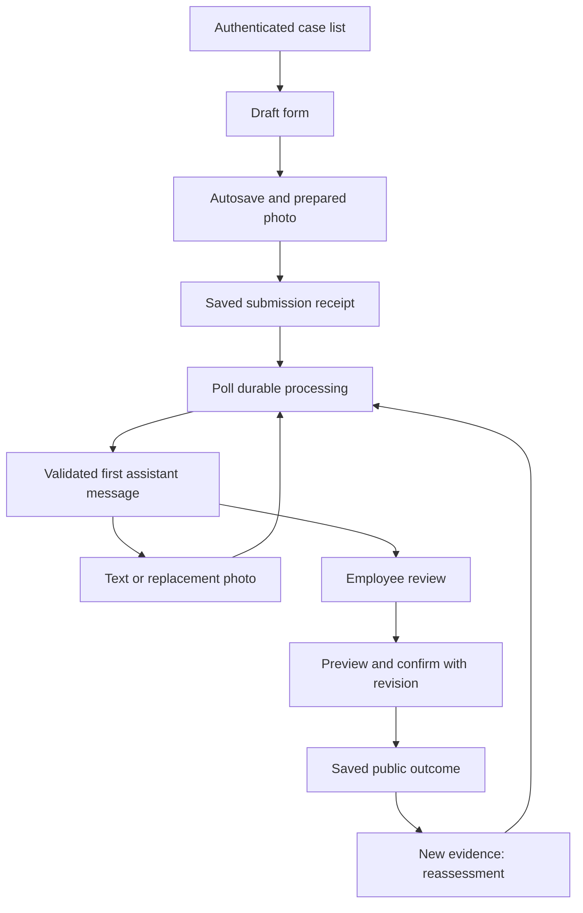
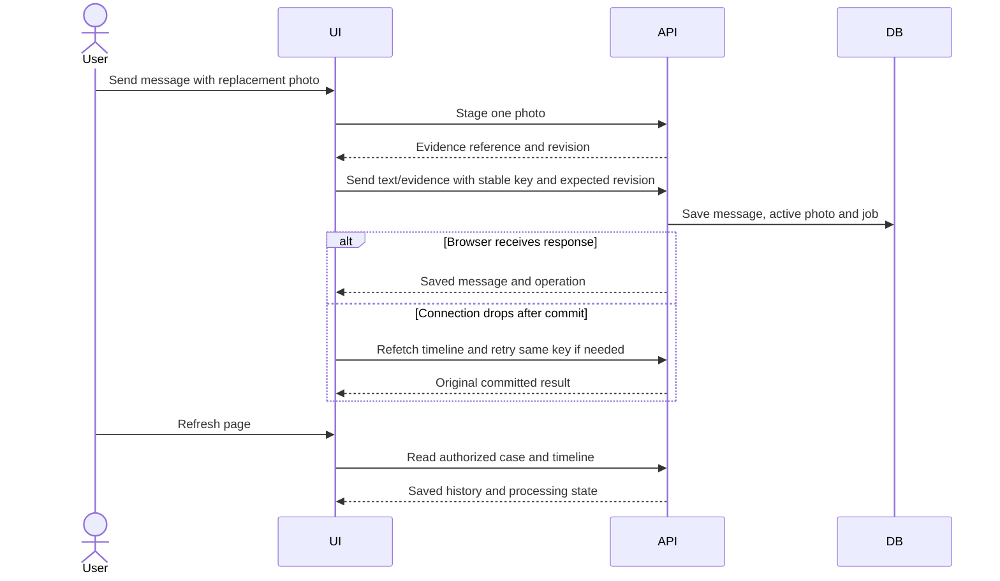

# ADR-004: Frontend State and Verification

**Date:** 2026-10-18

**Status:** Accepted for local MVP

**Relates to:** [Main architecture](000-main-architecture.md)

## 1. Scope

Research revision: [ADR-006](006-streaming-and-decision-flow.md) and [ADR-007](007-project-initialization-and-chat-ui.md) replace the original polling-only/no-chat-SDK guidance. The form, access, persistence and PRD verification requirements remain applicable.

Polish UI, navigation, form-to-chat transition, durable case rendering, local startup contract and verification across all PRD acceptance criteria. Visual identity remains in a later design document; no colors, fonts or brand assets are invented here.

## 2. Technology Documentation References

Official documentation checked on 2026-10-18; no verified Context7 IDs.

| Technology | Official documentation | Used for |
|---|---|---|
| Next.js | [Installation](https://nextjs.org/docs/app/getting-started/installation), [self-hosting](https://nextjs.org/docs/app/guides/self-hosting) | App Router and local Node server |
| Vitest | [Guide](https://vitest.dev/guide/) | Unit/integration runner |
| React Testing Library | [Introduction](https://testing-library.com/docs/react-testing-library/intro/) | User-observable component checks |
| Playwright | [Web server](https://playwright.dev/docs/test-webserver) | Real-stack E2E startup |
| Zod | [Documentation](https://zod.dev/) | Shared validation contracts |

## 3. Component Design

### Routes and views

| Route | View and access |
|---|---|
| /sign-in | Sign-in and verification-required state |
| /register | Customer registration only |
| /verify-email | Success, invalid/expired token, resend |
| /forgot-password and /reset-password | Recovery request and completion |
| /cases | Authorized customer list or employee queue |
| /cases/new | Create draft and show initial form |
| /cases/{id} | Processing/chat/detail based on persisted state |

Use server-rendered authenticated entry views and client components for interactive form, chat, upload and employee actions. Use TypeScript strict mode, Tailwind and current shadcn AI Elements patterns with AI SDK useChat/DefaultChatTransport. Do not add a second chat runtime or global state framework. Ordinary domain mutations remain same-origin JSON fetches; chat transport follows ADR-006.

The server is the source of truth. Browser state holds unsaved text, local File selection, send/upload status and current operation keys. Clear case caches on sign-out/account change. Do not persist private cases, session tokens or image blobs to localStorage. A page refresh restores saved state from the server; unsent text can be lost and is labeled unsaved.

Autosave draft fields after 750 ms of inactivity and on explicit save. Display saving/saved/failed, and a navigation warning when values are unsaved. Submission waits for pending draft/upload writes and uses the returned latest revision. If autosave returns 409, preserve the local text and show a reload/resolve prompt; do not blindly overwrite the newer draft.

Initial form contains exactly two case-type options and the seven PRD categories, with Polish labels. Show required reason only for complaint; changing to return preserves typed text as an optional reason. Use date picker plus keyboard entry and approximate-date toggle. Return intention advice/withdraw_now is a separate explicit control; choosing withdraw_now opens the declaration confirmation described in ADR-002. This is not inferred from choosing “Zwrot”.

Photo preview supports replace/remove and explains supported limits. A draft File not yet uploaded is explicitly marked unsaved; after upload, use the protected evidence endpoint for the durable preview. Keep required fields/valid values intact on validation failure. Client checks improve feedback; all validation is repeated on the server.

### Processing and chat

After successful submit, replace the draft URL with `/cases/{id}` and render the saved receipt immediately. Attach to the active AI SDK UI stream for progress and the committed first bubble. Poll summary/status every ten seconds while visible and refetch on focus; use two-second case-state polling as a degraded fallback while a stream is unavailable. The employee queue polls every ten seconds. Never overwrite active hook messages from a polling result. Before employee confirmation, submit the revision from the view; SSE/polling do not replace server concurrency checks.

Stream progress and real follow-up publicReply draft snapshots as specified in ADR-006. Drafts are explicitly uncommitted and not approvable; display a canonical recommendation only after schema, policy and revision validation plus durable commit. Initial processing has progress only before the complete first bubble. At 60 seconds show delayed assistance and human-review controls. Failed processing clears drafts and displays a status panel, not an invented assistant decision.

Render structured recommendation sections with fixed greeting/AI notice for the first bubble, then category, explanation, policy references, questions and numbered next steps. Public company/employee statements have a distinct actor label. Treat all generated/user text as text; no raw HTML, executable links or unrestricted Markdown. Only application-generated policy links point to approved internal policy views or the recorded source URLs.

Chat supports text up to 5,000 characters and one replacement photo per message. Assign an idempotency key at first send and retain it on transport retry. An ambiguous response triggers a server-state refetch before resending; do not mark committed messages unsent merely because the browser missed the response. Preserve later typed text when an older send completes. Enter sends; Shift+Enter inserts a line break; a visible send button remains available.

Public model-proposed facts appear as confirmation cards listing field, proposed value and source message. Users may confirm or edit; this creates typed facts through the facts endpoint. The UI does not represent an unconfirmed extraction as a verified receipt date. A withdrawal declaration confirmation uses its separate endpoint/receipt and fixed reviewed text.

### Employee view

Employee queue filters cases by awaiting_employee, needs_information, inspection_pending and reassessment_pending. Display received timestamp, product, status and latest update; do not claim that an AI acknowledgment satisfies a complaint response deadline.

Case view adds labeled internal analysis, notes and inspection findings. Publishing a public inspection statement requires an explicit preview separate from internal text. Approve is available only for a current actionable recommendation; override requires outcome and both private rationale and public explanation. Clarify and escalate are separate actions. Final preview displays exactly the content sent to the customer; never auto-fill public text with a private note.

A 409 leaves the employee's unsaved explanation available, reloads the current case into a review state and requires a new deliberate confirmation. A disabled button alone never establishes freshness. A final saved outcome stays in the timeline when reassessment starts.

### Accessibility and responsive behavior

Use semantic labels, associated field errors, focus on the first invalid field and live announcements for processing/save states. Do not announce every poll response or forcibly move focus on incoming chat. New messages show an accessible jump-to-latest control if the user is reading earlier history. At 360 CSS pixels, summary collapses and all primary actions remain available without horizontal page scroll. Validate keyboard order, visible focus, image descriptions and modal focus restoration.

## 4. Data Structures

| View contract | Content |
|---|---|
| DraftView | Persisted fields/evidence reference; case revision; local dirty/save state |
| CaseView | Public detail, statuses, receipt, current recommendation/outcome, revisions, active run ID, pagination cursors |
| Chat hook and draft preview | Typed UI messages plus transient progress/reply snapshots; never authoritative decisions |
| PendingMessage | Client ID/key, text/evidence reference, sending/failed/confirmed state |
| EmployeeReviewView | Explicit InternalCaseView, current recommendation and approval eligibility, unsaved action draft |
| ErrorView | Stable code, Polish message, field errors, retryable flag and request reference |

Do not maintain an independent client decision/status engine. Render the server-provided business/processing states. All internal UI data comes only from employee-authorized endpoints and is cleared on session/account transitions.

## 5. Interface Contracts

Consume ADR-002 endpoints without introducing a parallel server-action mutation surface. The Better Auth client owns account operations. Bind submission/retry to a saved operation reference and idempotency key; distinguish acknowledged success from optimistic rendering.

### Proposed implementation/startup scripts

No script listed here currently exists. During scaffolding, add and document these commands in the application package; validate them against the chosen package versions rather than claiming this ADR ran them.

| Script name | Required behavior |
|---|---|
| dev | Start web, worker and loopback-only Mailpit; no Docker prerequisite; report a failed dependency startup |
| build | Compile production web and worker artifacts without contacting external models |
| start | Start compiled web/worker against the configured local paths |
| db:migrate | Apply reviewed migrations once, before runtime startup |
| provision:employee | Explicit verified-account role change with recorded target |
| ai:qualify | Live synthetic model/provider/schema/privacy check, followed by scenario evaluation |
| test:unit / test:integration | Report discovered/passed/failed/skipped counts separately |
| test:e2e | Start isolated real local stack and run actual OpenRouter flows |
| lint / typecheck | Separate static verification |
| data:backup / data:restore | Consistent local snapshot and verified restore |
| data:reset | Explicit synthetic dataset reset, never automatic on startup |

Supply Mailpit as a documented local binary prerequisite with a pinned tested version. Docker may be offered later as an optional convenience but is not required by this local architecture. Bind application, Mailpit SMTP and inbox to loopback. Isolate E2E data directories/ports from the developer dataset and never reset the developer database from tests.

## 6. Technical Decisions

### Polling-only chat transport — superseded

**Status:** Superseded by the proposed streaming revision in ADR-006. **Date:** 2026-10-18.

**Context:** The first decision must be complete, validated and recoverable after refresh.

**Decision:** Original recommendation was polling-only. Current researched replacement uses SDK UI SSE with durable worker/replay, progress and labeled follow-up drafts. Canonical messages remain validated and committed before publication.

**Rejected alternatives:** Token streaming can expose invalid/incomplete decisions; WebSocket infrastructure adds complexity without a local requirement.

**Consequences:** (+) Refresh naturally restores the same output. (-) Up to the polling interval of display delay.

**Review trigger:** Measured polling overhead or a justified live collaboration requirement.

### Server-owned state with small local drafts

**Status:** Accepted. **Date:** 2026-10-18.

**Context:** Shared cases and role separation make browser storage unsuitable as authoritative persistence.

**Decision:** Server records own state; client retains only pending interaction data and explicitly saves drafts.

**Rejected alternatives:** LocalStorage case recovery cannot synchronize employees and customers and risks cross-account disclosure; global client state tooling adds little here.

**Consequences:** (+) Consistent shared state. (-) Unsent text/local files do not survive every refresh.

**Review trigger:** An explicit offline-use requirement.

## 7. Diagrams

## 8. Testing Strategy

### Required method and evidence

Follow red → green → refactor for implementation. Unit mocks cover dependencies; integration mocks only external LLM calls, derived from fresh authorized synthetic captures. Real auth/database/files/email remain active. E2E mocks nothing. Maintain an explicit coverage ledger linking each PRD acceptance criterion to executable verification and manual evidence where applicable; ranges below allocate responsibility and are not a claim that tests exist.

| PRD criteria | Verification scope | Primary layer |
|---|---|---|
| AC-01–06 | Accounts, current role, ownership and employee-created case | Integration + real-stack E2E |
| AC-07–15 | Form selectors, limits, input preservation and committed receipt | Component + integration + manual |
| AC-16–21 | Transform metadata/orientation, unsuitable image and version preservation | Integration + real model scenarios |
| AC-22–31 | Scenario prompts, first response, legal distinctions, missing policy and citations | Unit contract + integration + model evaluation |
| AC-32–37 | Full history, corrections, review, clarification counter and injection | Unit + integration + real model E2E |
| AC-38–46 | Employee actions, private projections, recovery, failure and concurrency | Integration + two-role E2E |
| AC-47–52 | Polish copy, keyboard, 360px layout, loading/delay and AI labeling | Component + E2E + manual |

### Key scenarios

| Scenario | Input/condition | Expected behavior | Layer |
|---|---|---|---|
| Complaint happy path | Valid photo and visible/functional symptoms | Receipt, first bubble, chat and employee confirmation | E2E + manual |
| Return happy path | Online purchase, confirmed delivery/declaration dates | Separate rights/condition treatment; no assumed resale certification | E2E + model evaluation |
| Incomplete form | Blank complaint reason, future date, oversized photo | Field-specific Polish errors, other values retained | Component/integration |
| Model unavailable | Real checkpoint followed by captured provider failure | Receipt/history preserved, retry/review available | Integration |
| Refresh/restart | Saved draft/chat, queued/running job | Durable state restored; no duplicate published output | Integration/E2E |
| Replacement after outcome | New photo on confirmed case | New evidence version, reassessment, prior decision preserved | Integration/E2E |
| Concurrent employees | Two approval forms from one revision | One success, one stale conflict | Integration/E2E |
| Internal privacy | Private sentinel in note/hypothesis | Absent from customer API, HTML, client cache and model context | Integration/E2E |
| Explicit withdrawal | Advice then confirmed declaration during outage | Distinct saved receipt, no invented declaration from advice | Integration/E2E |
| Keyboard/mobile | 360px width; keyboard-only form/chat/modal | Reachable actions, labeled errors, no page overflow | Manual/E2E |

Model evaluation gate is defined in ADR-003. A transport/schema mock cannot establish legal or visual quality; use the actual candidate models for that gate. Provider outages or unavailable credentials are reported explicitly with failed/blocked checks, not converted into passing mocked E2E. No live calls are required merely to review this documentation.

### Local scale experiment

After correctness checks, run a synthetic experiment with 20 concurrent authenticated sessions for five minutes, including mixed reads and case/chat writes. Target p95 non-upload/non-AI API latency below 500 ms on a recorded development machine, under 1% database-busy write failures and zero cross-user leaks, lost committed receipts or duplicate actions. Separately run two concurrent real model jobs and record provider latency, queue wait and cost; there is no promised LLM latency SLA. Report machine specs and measurement method so the result is interpretable. These targets are proposed implementation gates, not current measurements.

### Manual QA and completion

Start the actual app and record successful startup separately from compilation. Use Chrome DevTools CLI per repository guidance to exercise customer registration/verification, complaint and return forms, upload, form-to-chat transition, follow-up, replacement photo, refresh, employee confirmation and override. Use distinct accounts and verify unauthorized direct links fail. Capture screenshots of touched screens, check console errors and Polish copy, and inspect keyboard/mobile behavior.

Before UI implementation is considered visually complete, establish the agreed brand reference and design guidelines; compare screenshots to them as AGENTS.md requires. This ADR does not substitute for missing visual design approval. Documentation checks do not imply runtime checks passed.

- TAC-004-01: Refresh retrieves committed form, message, image and outcome state from the server rather than a browser case cache.
- TAC-004-02: UI never labels an action saved before its commit acknowledgment or verified idempotent replay result.
- TAC-004-03: A stale employee confirmation preserves draft explanation and requires renewed review before retry.
- TAC-004-04: Unit/integration/E2E counts, skips, build, startup and manual evidence are reported separately.
- TAC-004-05: All 52 PRD criteria have verifiable coverage and unresolved failures are disclosed before implementation completion.
