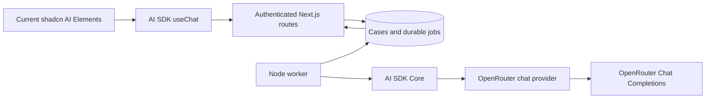
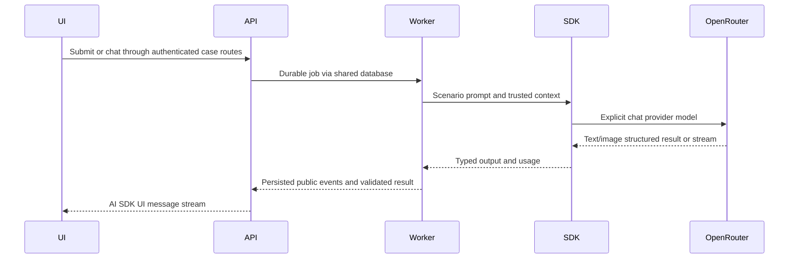

# ADR-005: AI SDK and OpenRouter — Research and Option Selection

**Date:** 2026-10-18

**Status:** Proposed researched revision; requested Context7 MCP verification unavailable

**PRD:** [Hardware Service Decision Copilot](../PRD.md)

**Relates to:** [Main architecture](000-main-architecture.md), [streaming contracts](006-streaming-and-decision-flow.md), [initialization and components](007-project-initialization-and-chat-ui.md)

## 1. Scope and Research Method

This revision replaces the earlier native-fetch/polling-only recommendation with AI SDK Core/UI, an explicit OpenRouter provider and streaming-capable chat components. Existing local operation, SQLite/private photos, authenticated customer/employee access, immutable case history and employee confirmation remain requirements.

The six architecture answers already supplied in this conversation are retained: recommend the stack/storage/auth; local execution; retain OpenRouter; pilot scale. The latest instruction specifies Next.js App Router and TypeScript strict mode. No repeated clarification or implementation is needed to compare the requested options.

### Context7 availability and evidence limit

The user supplied Context7 library ID `/vercel/ai`. This session exposes no `query-docs`/`resolve-library-id` tools, and querying resource templates for server `context7` returned `unknown MCP server 'context7'`. Therefore **no Context7 MCP query succeeded**. `/vercel/ai` is recorded as user-supplied, not verified by MCP. These recommendations use official documentation read during this task, not remembered API patterns. Repeat targeted MCP queries for streaming, structured output, persistence and multimodal messages when the server is available; this requested verification remains outstanding.

No package installation, live provider call, performance measurement or implementation is claimed. References to current release lines are documentation findings; pin and test exact published versions during scaffolding.

## 2. Technology Documentation References

All six requested links were opened before selection. Redirects and important distinctions are recorded here.

| Requested source | Read result | Role in decision |
|---|---|---|
| [vercel/ai](https://github.com/vercel/ai) | AI SDK repository | SDK scope and provider architecture |
| [AI SDK docs](https://ai-sdk.dev/docs) | Redirects to current introduction, labeled v7 | Current Core/UI documentation |
| [chat-sdk.dev](https://chat-sdk.dev/) | Currently a platform-bot SDK | Distinguish from a browser-chat application template |
| [OpenRouter Responses overview](https://openrouter.ai/docs/api_reference/responses/overview) | Current Responses contract | Compare endpoint and state behavior |
| [OpenRouter AI SDK integration](https://openrouter.ai/docs/guides/community/vercel-ai-sdk) | Provider installation/integration guide | Provider selection; examples cross-checked against current AI SDK |
| [OpenRouter docs](https://openrouter.ai/docs) | Redirects to quickstart | Gateway and authentication boundary |

| Additional primary source | Current finding used |
|---|---|
| [Provider repository](https://github.com/OpenRouterTeam/ai-sdk-provider), [package manifest](https://raw.githubusercontent.com/OpenRouterTeam/ai-sdk-provider/main/package.json) | Current source line targets `ai@^7`, Node >=22 and ESM; manifest supports Zod 3.25.76 or 4.1.8 onward within their majors |
| [Structured output](https://ai-sdk.dev/docs/ai-sdk-core/generating-structured-data) | `generateText`/`streamText` with `Output.object`; incomplete objects are not fully validated |
| [Chatbot](https://ai-sdk.dev/docs/ai-sdk-ui/chatbot), [transport](https://ai-sdk.dev/docs/ai-sdk-ui/transport) | `useChat`, `DefaultChatTransport`, UI message parts |
| [AI SDK persistence](https://ai-sdk.dev/docs/ai-sdk-ui/chatbot-message-persistence) | Application owns persistence and message identity |
| [AI SDK resume](https://ai-sdk.dev/docs/ai-sdk-ui/chatbot-resume-streams) | Reconnection requires storage/integration, not a hook option alone |
| [Current shadcn AI Elements](https://ui.shadcn.com/docs/ai-elements) | Copyable patterns rather than a hosted chat backend |
| [Legacy AI Elements](https://elements.ai-sdk.dev/) | Announces move to shadcn/ui and deprecation at end of November 2026 |
| [assistant-ui runtime](https://www.assistant-ui.com/docs/runtimes/ai-sdk/overview), [v7](https://www.assistant-ui.com/docs/runtimes/ai-sdk/v7) | Current v7 adapter packages and runtime choices |
| [Actual web-chat template](https://github.com/vercel/chatbot) | Separate Next.js template with persistence/auth/storage/provider defaults |
| Context7 `/vercel/ai` | User-supplied ID; MCP verification pending, not a successful source lookup |

## 3. Comparison and Recommendation

These choices are different layers, not interchangeable competitors: the AI SDK is a toolkit, an OpenRouter provider is an adapter, Responses is an upstream API, a template is an application starting point, and UI components render the application.

| Option | PRD fit | Work still required | Recommendation |
|---|---|---|---|
| AI SDK Core + UI | Streaming, structured output, multimodal messages and React hook | Ownership, image compression, policy rules, durable jobs and employee decisions | Select as application AI boundary |
| OpenRouter provider for AI SDK | Uses existing OpenRouter credentials/model IDs within Core APIs | Capability/privacy qualification and model configuration | Select together with AI SDK; explicitly choose chat model API |
| Direct OpenRouter Responses API | Valid alternative for text/reasoning/tools | Responses-event to UI-protocol adapter and all case persistence | Do not select for MVP; no required feature offsets extra integration |
| `chat-sdk.dev` as currently documented | Platform bots and event handlers | Does not supply this browser form/case/chat UI | Exclude unless Slack/Teams or other messaging channels enter scope |
| Actual `vercel/chatbot` template | Useful streaming-chat reference and working starting UI | Replace/adapt general chat domain and chosen infrastructure | Reference only; initialize a smaller app from empty scaffold |
| Current shadcn AI Elements + `useChat` | Composable thread, composer and streaming presentation | Custom decision/inspection/status components | Select for UI |
| assistant-ui with current v7 adapter | Strong ready-made chat runtime, primitives and attachment/history adapters | Integrate custom case transport and avoid duplicate state/role behavior | Viable runner-up; prefer when richer thread/branch/runtime features become requirements |

### Important source findings

`chat-sdk.dev` currently describes cross-platform bots, including Slack/Teams/Discord adapters. The browser-chat template intended by the brief is a different project, `vercel/chatbot`. Its documented defaults include Neon Postgres, Vercel Blob, Auth.js and AI Gateway. For this local case-management product, replacing those defaults and adding employee workflows is more work than composing the required pieces in a clean Next.js scaffold. This is a product-fit judgment, not a claim that the template cannot run locally. [Sources: Chat SDK](https://chat-sdk.dev/), [web template](https://github.com/vercel/chatbot).

OpenRouter Responses uses `https://openrouter.ai/api/v1/responses`. Its overview explicitly says the API is stateless: full history must be sent, `store:true` and non-null `previous_response_id` are rejected. It does not remove the PRD's need for a shared case database. Chat Completions plus the documented provider already covers our scoped image/text/reasoning needs and integrates with AI SDK UI. Do not reject Responses merely because older material called it beta; the reasons here are interface fit and unneeded adaptation. [Source](https://openrouter.ai/docs/api_reference/responses/overview).

AI SDK UI supplies hooks and transport, not ready-styled bubbles. The current shadcn AI Elements patterns supply view building blocks without another chat runtime. The legacy Elements site announces a migration; start from the current destination rather than copying old installation instructions. assistant-ui documents `ai@^7` with `@ai-sdk/react@^4` and `@assistant-ui/ai-sdk`; its older `@assistant-ui/react-ai-sdk` examples belong to legacy release lines. [Sources: UI](https://ai-sdk.dev/docs/ai-sdk-ui/chatbot), [migration](https://elements.ai-sdk.dev/), [current Elements](https://ui.shadcn.com/docs/ai-elements), [assistant-ui](https://www.assistant-ui.com/docs/runtimes/ai-sdk/overview).

### Version-specific examples

Do not combine examples solely because they appear on an official page. The OpenRouter integration guide establishes the provider factory, but some examples still use older tool-schema names. Current AI SDK v7 documentation uses `instructions`, `Output.object`, UI message `parts`, and the current UI-stream response helpers. Cross-check each signature with the installed v7 types and matching provider release; reject an incompatible recipe rather than adopting its remembered legacy equivalent. The provider manifest is release-line evidence, not proof of published-package availability.

## 4. Technical Decisions

### Explicit OpenRouter model adapter

**Status:** Proposed. **Date:** 2026-10-18.

**Context:** Credentials already target OpenRouter. A bare model string in current AI SDK examples can resolve through a different default gateway.

**Decision:** Use `createOpenRouter` from `@openrouter/ai-sdk-provider` and an explicit `.chat(modelId)` model. This targets OpenRouter Chat Completions, not Responses and not Vercel AI Gateway. Never pass the environment model string alone as the SDK model value.

**Rejected alternatives:** Native fetch requires manual SDK UI adaptation; OpenAI provider default endpoint selection risks unintended Responses behavior; a default gateway would require different credentials.

**Consequences:** (+) One typed integration for vision and chat. (-) Provider/SDK compatibility must be verified as a set.

**Review trigger:** A required Responses-only feature, adapter incompatibility or provider retirement.

### Current primitives instead of a complete chat template

**Status:** Proposed. **Date:** 2026-10-18.

**Context:** The primary product is a decision case with a form, two audiences and employee controls. General chat features do not replace these workflows.

**Decision:** Initialize Next.js, then add current shadcn AI Elements primitives and AI SDK UI. Do not clone the full chatbot app or install the platform-bot SDK.

**Rejected alternatives:** Full template entails replacing its domain/infrastructure defaults; assistant-ui introduces an additional runtime with features outside MVP scope; building every chat primitive from scratch discards useful existing components.

**Consequences:** (+) Direct control over case-specific rendering and authorization. (-) Our application owns integration and component updates.

**Review trigger:** Need for branching, rich tool interactions or multiple managed chat runtimes.

## 5. Data and Interface Boundaries

The domain records from ADR-002 remain authoritative. `UIMessage` is a presentation format with a schema version, not a substitute for a case, recommendation or employee action. Convert saved public records to UI messages and construct trusted model context server-side. Never accept a client-submitted assistant message, system instruction or recommendation as an authoritative stored result.

Provider streaming events and the AI SDK UI message protocol are different boundaries. A raw OpenRouter SSE response cannot simply be returned to `useChat` as if it were its UI protocol. ADR-006 defines that bridge and durable execution.

## 6. Diagrams

## 7. Testing Strategy

TDD and the existing unit/integration/E2E rules still apply. In particular, mock only the external LLM in integration, using a fresh synthetic real capture; UI helper demos are not real-stack E2E.

- TAC-005-01: A captured synthetic request targets OpenRouter `/api/v1/chat/completions`, never a default AI Gateway or `/responses` endpoint.
- TAC-005-02: Exact installed SDK, React hook and provider versions satisfy peer dependencies without forced resolution.
- TAC-005-03: Neither `store:true` nor `previous_response_id` is used to claim conversation persistence.
- TAC-005-04: Before implementation relies on `/vercel/ai` MCP research, record successful query results or continue explicitly reporting that requirement as unmet.

No test or research status in this file is evidence of a live model result. Additional acceptance criteria are in ADR-006/007.
