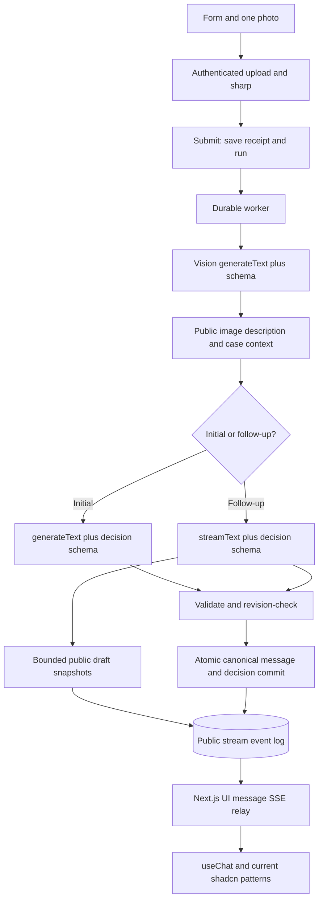
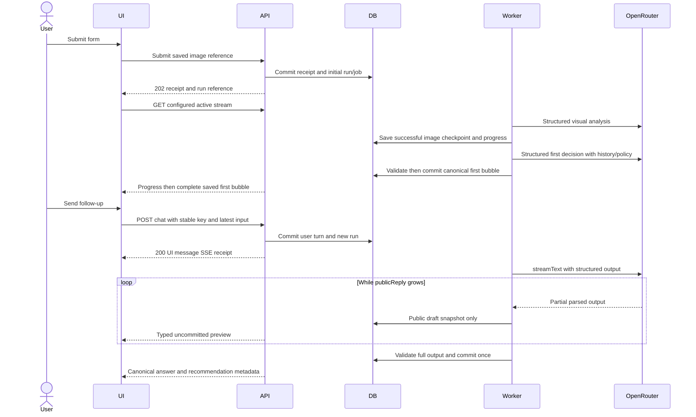

# ADR-006: Streaming, Multimodal Analysis and Decision Publication

**Date:** 2026-10-18

**Status:** Proposed researched revision; Context7 MCP check pending as recorded in ADR-005

**Relates to:** [Main architecture](000-main-architecture.md), [option research](005-ai-sdk-options-and-research.md), [UI initialization](007-project-initialization-and-chat-ui.md)

## 1. Scope

Map form → image analysis → first decision → follow-up chat to authenticated endpoints and AI SDK primitives. Preserve durable worker recovery, full authorized history and employee approval. Streaming is a display mechanism; it does not make an incomplete model result a recorded decision.

## 2. Technology Documentation References

| Primary source | Pattern used |
|---|---|
| [AI SDK App Router](https://ai-sdk.dev/docs/getting-started/nextjs-app-router) | Route-handler integration |
| [Structured data](https://ai-sdk.dev/docs/ai-sdk-core/generating-structured-data) | `generateText`/`streamText`, `Output.object` and incomplete-object distinction |
| [streamText reference](https://ai-sdk.dev/docs/reference/ai-sdk-core/stream-text) | Current stream/result lifecycle |
| [Custom UI data streams](https://ai-sdk.dev/docs/ai-sdk-ui/streaming-data) | Typed progress and draft data parts |
| [UI persistence](https://ai-sdk.dev/docs/ai-sdk-ui/chatbot-message-persistence) | Stable IDs and server-side history |
| [UI stream resumption](https://ai-sdk.dev/docs/ai-sdk-ui/chatbot-resume-streams) | Active stream tracking and full replay behavior |
| [AI SDK multimodal prompts](https://ai-sdk.dev/docs/foundations/prompts) | Server-owned image message parts |
| [OpenRouter image input](https://openrouter.ai/docs/guides/overview/multimodal/image-understanding) | Private image bytes rather than public URLs |
| [OpenRouter provider](https://openrouter.ai/docs/guides/community/vercel-ai-sdk) | Provider connection |
| [OpenRouter reasoning](https://openrouter.ai/docs/guides/best-practices/reasoning-tokens) | Reasoning configuration and output headroom |

Context7 `/vercel/ai` was supplied by the user but could not be queried. References above were read directly. This architecture's SQLite-backed stream relay is an application design, not an SDK feature claimed to exist out of the box.

## 3. Component Design

### Recommended execution flow

| Stage | Backend operation | AI primitive | Public display |
|---|---|---|---|
| Draft form/photo | Save draft and prepare compressed private evidence | None | Form and durable preview |
| Submit | Commit form snapshot, receipt and initial run/job | None | Received reference and processing status |
| Complaint/return image analysis | Worker reads compressed evidence and scenario prompt | `generateText` with `Output.object(VisionResult)` and a user message containing text plus image bytes | Progress only; private hypotheses are not streamed |
| First recommendation | Worker assembles full public context and pinned scenario policy | `generateText` with `Output.object(DecisionResult)` | First complete bubble after validation and commit |
| Follow-up text | Save user message and new run, reuse current image description | `streamText` with `Output.object(DecisionResult)` | Real incremental `publicReply` draft, followed by committed answer |
| Replacement photo | Prepare one image; attach via saved chat message | New visual analysis before the same follow-up decision stage | Analysis progress then reply draft |
| Employee confirmation | Transaction against current recommendation/revision | None | Employee-confirmed public outcome |

Use the four existing scenario prompts. Extend the decision result contract with `publicReply`, a Polish response up to 5,000 characters, and `changeSummary`, up to 1,000 characters. Preserve recommendation category, policy references, questions, missing facts and next steps from ADR-003. Initial first-bubble headings/notice are fixed application rendering, not optional model prose. Subsequent replies still include the current AI recommendation label where appropriate.

For visual input, pass the server-loaded compressed JPEG bytes in an AI SDK image part, with its media type, after the text instruction. The provider serializes it for OpenRouter. Never forward browser-original files, arbitrary remote URLs or client-authored model messages. A protected preview URL is for the browser; the upstream model does not receive that URL. Compression, size/pixel limits, immutable versions and EXIF removal remain as specified in ADR-003.

### Streaming versus validation

`streamText` can produce partial parsed objects, but those are not complete schema-validated results. Therefore the selected product flow streams only an allowlisted `publicReply` draft for follow-up turns. It does not stream raw JSON, category updates, private visual observations, reasoning tokens, rule text or the entire provider stream.

Convert each partial reply into a replaceable typed data snapshot, not append-only text inferred from incomplete JSON. This accommodates partial parser corrections. Label the preview “Szkic AI — trwa generowanie; to nie jest decyzja”. The current saved recommendation stays visible and employee approval remains disabled for the active new run. Initial analysis/decision has progress only, so the first actual chat bubble always satisfies PRD AC-23.

When the complete SDK output is available, validate the full schema, clause IDs, applicable route facts and captured input revision. Then atomically save the canonical assistant message/recommendation and completion event. Only after commit emit canonical message parts and the stable recommendation reference. No additional prose-generation call is needed; final content comes from that same complete structured result. The final rendering need not be identical to every transient snapshot, and previews are never cited as evidence.

On invalid output, stale evidence, failure or cancellation, clear the preview, show a safe status and publish no decision. A user may have seen provisional public text before final validation; the explicit draft label is essential and is not a guarantee that provisional claims are correct. If evaluation finds such drafts misleading, disable draft text while retaining progress streaming; do not relax decision validation.

### AI SDK v7 integration pattern

Use `useChat` from `@ai-sdk/react`, with `DefaultChatTransport` explicitly configured to the case chat endpoint. Render `UIMessage.parts`, not an assumed legacy `content` string. Use typed `onData` handling for progress/draft updates. The backend constructs its UI message stream with `createUIMessageStream` and `createUIMessageStreamResponse`.

For ordinary unstructured SDK chat, the current docs show `streamText`, `toUIMessageStream({stream: result.stream})` and `createUIMessageStreamResponse`. That is the researched baseline, not the direct forwarding selected here: raw structured JSON would be inappropriate customer text. Our relay emits selected typed data and then the committed message. Prefer v7 `stream` and `onEnd` names over deprecated `fullStream`/`onFinish` examples. Match exact installed type signatures before implementation.

### Durable worker, stream storage and recovery

Keep the independent worker from ADR-003. The web route accepts/attaches to work; it does not own model lifetime. Add an application-managed StreamRun record and a public event log in SQLite. The worker consumes model output continuously even if all browsers disconnect. Persist only public-safe progress/draft snapshots and final canonical message chunks; never store raw provider chunks or reasoning for replay.

Each run has a stable assistant message ID, captured inputRevision, attempt ID, current lease token and increasing event sequence. Preview-event writes do not increment caseRevision or inputRevision; only domain mutations do. The worker conditionally writes public events only while its lease/revision remain valid. Batch draft snapshots at most once per 250 ms; keep only the latest unsent snapshot. Set a 512 KiB per-run preview-event budget. At that threshold stop adding preview snapshots, emit a preview-paused progress event once and reserve separate space for terminal/canonical events. Exhausting preview storage must not prevent the final decision commit.

The route tails committed public events every 250 ms while connected, sends an SSE keepalive every 15 seconds and ends on a terminal event. It performs current session/case authorization before each batch. Disconnect closes this reader, not the worker job. A locally chosen five-minute reader limit may close a connection; clients can reconnect without creating another job.

For refresh/reconnect, seed `useChat` with saved canonical messages, use the case ID as chat ID, and configure the GET reconnect URL. When a run is active, return a full replay from its start followed by new events. `DefaultChatTransport`'s documented replay behavior resets/rebuilds the interrupted response. Stable message IDs and authoritative final history prevent duplicates. Return 204 when no active run exists, then refetch canonical history to close completion races.

The SDK guide's ready-made resume example uses Redis and `resumable-stream`. We do not claim that setting `resume:true` gives SQLite persistence. The selected local implementation supplies its own compatible replay log and endpoints, verified by protocol tests; no Redis dependency is added. A worker crash cannot resume an upstream model's token position: after lease expiry, invalidate that attempt's preview and restart the incomplete stage under the existing bounded retry policy. Keep the successfully saved image analysis checkpoint. Reset replay identity per attempt while linking all attempts to one operation.

Keep replay events until 24 hours after terminal completion, then purge them. Permanent case messages/recommendations remain governed by the synthetic dataset lifecycle. A pruned/finished run is restored through canonical history, not a new model request.

### Cancellation and retry ownership

Add a dedicated cancellation mutation; `useChat.stop()` alone only detaches the stream in this durable design. The UI stop button first saves cancellation of the specified run, then detaches. The worker observes the cancellation flag on its heartbeat and aborts its upstream signal; publication checks also reject cancelled runs, even if abort arrives too late. Preserve receipt, submitted user message and successful checkpoints. If completion won the transaction race, return already_complete and load the completed answer instead.

Set AI SDK automatic retries to zero; the durable worker alone owns the existing three-attempt policy, timeouts and spend reservations. Otherwise SDK retries multiply the intended upper bound. Do not retry a failed browser stream by creating another user message or calling unrestricted regenerate. Reconnect to saved work first; explicit regenerate remains hidden in MVP. Server-side retry uses a new attempt within the authorized operation.

## 4. Data Structures

| Structure | Fields and rules |
|---|---|
| StreamRun | Run/operation/case IDs; stable assistant ID; inputRevision; state queued/running/completed/failed/cancelled/superseded; active attempt; lease; timestamps |
| StreamEvent | Run/attempt/sequence; public-safe typed payload; createdAt; unique sequence; no internal records |
| Public UIMessage | Stable ID, role, typed text/data parts; metadata with committed state, case/recommendation references and schema version |
| Progress data | Run ID, phase queued/image_analysis/decision/validating/saving, delayed flag; no artificial percentage |
| Draft data | Run/attempt ID, snapshot number, bounded publicReply text; transient and explicitly uncommitted |
| Commit data | Saved message/recommendation IDs, new case revision, outcome status and canonical rendering reference |

Transient preview records are operational display data, not saved conversation turns supplied to the next model call. Full public canonical history, original form, image descriptions and corrections remain in server-owned context. Internal notes stay outside every public model request and replay event.

## 5. Interface Contracts

Existing JSON case/evidence/employee endpoints from ADR-002 remain. The following additions use its authentication, idempotency, revision checks and safe errors.

| Endpoint | Input | Output and semantics |
|---|---|---|
| POST /api/v1/cases/{id}/chat | Latest user message ID/text, optional staged evidence ID, expectedCaseRevision; Idempotency-Key | Before headers: validate and commit message/run/job. Success: 200 AI SDK UI SSE, beginning with saved-receipt data and then tailed run events. Failure before stream: normal 4xx/503 JSON. Never 202 JSON to DefaultChatTransport. |
| GET /api/v1/cases/{id}/chat/stream | Authorized case; optional expected run ID; configured reconnect URL | 200 full replay/live AI SDK UI stream for active run; 204 if none; 404 for inaccessible case. No job creation. |
| POST /api/v1/cases/{id}/chat/runs/{runId}/cancel | Expected revision; stable idempotency key | Saved cancelled state or already_complete. This is an explicit business mutation, not a network disconnect. |
| POST /api/v1/cases/{id}/submit | Existing complete form/evidence contract | 202 receipt plus run ID; navigate to case page and attach GET stream. No invented user chat message is needed to start the first decision. |

POST `/messages` remains a JSON alternative for operational clients; it and `/chat` call the same message/run transaction service. They must not both be called for one send. Idempotency scope is the domain message operation across both routes, so a retry cannot duplicate a turn by changing transport. Prefer `/chat` for the React composer.

`prepareSendMessagesRequest` sends only the latest user input, stable IDs and revision/evidence references. Do not trust the client's full message array, model ID, policy, owner, role, system text, remote attachment URL or purported assistant messages. Server rebuilds all historical context. Cookies stay same-origin; OpenRouter credentials never enter browser transport settings.

Protocol envelopes use one stable start/message ID, typed data parts, properly paired text-start/text-delta/text-end for the final committed rendering, and one terminal finish or error sequence. Do not forward provider framing or reconstruct arbitrary JSON as text deltas. Initial transient progress must not render an empty first assistant bubble.

Once SSE headers are sent, report errors through safe typed stream events, then terminate with a failed status; do not attempt to change HTTP status midstream. Completed protocol envelopes do not themselves prove a successful business commit: the client requires committed metadata or a canonical-history refetch.

## 6. Technical Decisions

### Hybrid validated decisions and genuine follow-up preview streaming

**Status:** Proposed. **Date:** 2026-10-18.

**Context:** The user requests streaming, while the PRD requires a complete explained first decision and human confirmation.

**Decision:** Use structured non-streaming vision/first-decision generation; follow-up `streamText` produces real draft snapshots; publish canonical decisions only after full validation/commit.

**Rejected alternatives:** Forwarding raw structured JSON is unusable; treating partial objects as accepted decisions is incorrect; simulated typewriter output after completion does not reduce model wait.

**Consequences:** (+) Responsive follow-up with an explicit decision boundary. (-) First-decision latency remains whole-result latency, and draft preview needs a product-specific component.

**Review trigger:** Evaluation shows misleading draft text, or latency measurements justify a changed UX.

### SQLite-backed UI stream relay for local durable execution

**Status:** Proposed. **Date:** 2026-10-18.

**Context:** The worker already persists cases/jobs; streaming must survive a browser disconnect without adding a mandatory service.

**Decision:** Persist a bounded public replay log and expose UI-protocol SSE readers. Use application cancellation and worker-owned retry.

**Rejected alternatives:** A request-only stream loses crash recovery; Redis-backed resume adds another service; one in-memory stream cannot restore after worker/web restart.

**Consequences:** (+) One durable local store. (-) A custom replay bridge needs contract and race testing; upstream generation may repeat after crash.

**Review trigger:** Public/multi-host deployment or excessive SQLite write contention from stream events.

## 7. Diagrams





```mermaid
sequenceDiagram
    participant UI
    participant API
    participant DB
    participant Worker
    UI->>API: Stream connection
    UI--xAPI: Refresh or connection loss
    Worker->>DB: Continue run and public events independently
    UI->>API: Reload canonical history and reconnect GET
    API->>DB: Authorize and read active run
    alt Run active
        API-->>UI: Full replay from start, then live events
    else Run completed
        API-->>UI: 204; refetch committed history
    end
    UI->>API: Explicit cancel run
    API->>DB: Save cancellation if not already complete
    Worker->>DB: Observe flag and prevent result publication
```

## 8. Testing Strategy

Use TDD and repository mock-capture rules. Unit tests cover context projection, snapshot mapping and SDK retry configuration. Integration uses real SQLite/files/auth/email and SDK parsing with only captured external LLM responses mocked. E2E exercises actual OpenRouter streaming, form receipt, image replacement, disconnect and employee decisions.

- TAC-006-01: A partial category, raw JSON or reasoning chunk never becomes customer text or an approvable recommendation.
- TAC-006-02: A follow-up shows at least one genuine pre-completion reply snapshot when the real model emits such data; no artificial typewriter delay substitutes for streaming.
- TAC-006-03: The first assistant bubble appears only after its required fields and references are validated and committed.
- TAC-006-04: Refresh during a run reconnects/reloads without a second user message, duplicate recommendation or new model job.
- TAC-006-05: Invalid/stale/cancelled output clears the preview and cannot overwrite the current saved outcome.
- TAC-006-06: Direct GET stream access for another customer's case returns 404 and no replay bytes.
- TAC-006-07: SDK retries are zero and worker attempts never exceed the configured bound per stage/run.
- TAC-006-08: Image inference receives transformed server-owned bytes; client URLs cannot trigger backend URL fetching.
- TAC-006-09: Completion during reconnect or cancellation yields one canonical result with stable IDs.
- TAC-006-10: After a worker crash, partial text is not marked complete; lease-based recovery may restart generation and reports this limitation honestly.
