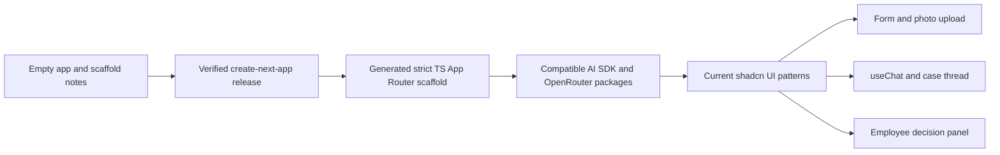
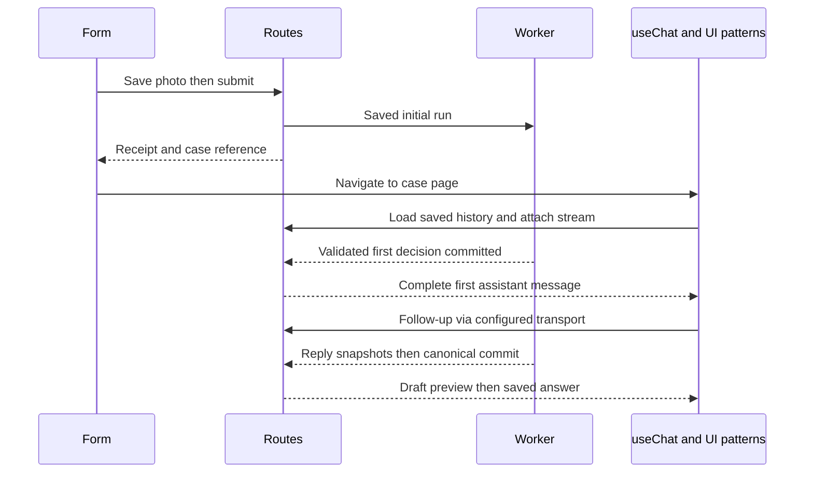

# ADR-007: Initialize the Empty App and Compose the Chat UI

**Date:** 2026-10-18

**Status:** Proposed researched revision; Context7 MCP check pending as recorded in ADR-005

**Relates to:** [Main architecture](000-main-architecture.md), [research comparison](005-ai-sdk-options-and-research.md), [decision/stream contracts](006-streaming-and-decision-flow.md)

## 1. Scope

Specify how a future implementation agent initializes the currently empty application, installs compatible AI/UI libraries and connects ready-made components to case routes. This task only writes documents; do not execute scaffolding, create application code or install dependencies while preparing this ADR.

The existing `app/README.md` is a course scaffold note, not an initialized application. There is no package manifest, lockfile, test runner or runnable app to preserve. The repository root, existing docs and user changes must remain intact.

## 2. Technology Documentation References

| Source | Use |
|---|---|
| [create-next-app](https://nextjs.org/docs/app/api-reference/cli/create-next-app) | Generator options instead of hand-written scaffold configuration |
| [Next.js TypeScript](https://nextjs.org/docs/app/api-reference/config/typescript) | Generated TypeScript setup and type checking |
| [Published Next.js manifest](https://registry.npmjs.org/next/latest) | Reports 16.4.2 at research time; recheck before installing |
| [AI SDK App Router](https://ai-sdk.dev/docs/getting-started/nextjs-app-router) | Server/client package boundaries |
| [OpenRouter provider manifest](https://raw.githubusercontent.com/OpenRouterTeam/ai-sdk-provider/main/package.json) | SDK/provider peer constraints |
| [Current shadcn AI Elements](https://ui.shadcn.com/docs/ai-elements) | Composable source-owned patterns |
| [Chat pattern](https://ui.shadcn.com/docs/ai-elements/base/chat) | Message Scroller, Message, Bubble and Input Group |
| [Prompt Input pattern](https://ui.shadcn.com/docs/ai-elements/base/prompt-input) | Composer composition |
| [Legacy Elements notice](https://elements.ai-sdk.dev/) | Avoid starting on the outgoing component registry |
| [assistant-ui v7 runtime](https://www.assistant-ui.com/docs/runtimes/ai-sdk/v7) | Alternative and adapter integration |
| [shadcn AI SDK helper](https://ui.shadcn.com/docs/helpers/ai-sdk) | Distinguish offline scripted UI previews from actual model tests |

Context7 `/vercel/ai` is user-supplied and remains unqueried because the MCP server is unavailable. Registry lookup did not establish published latest versions of every package; do not treat repository main as proof that a release is on npm.

## 3. Component and Initialization Design

### Ordered initialization procedure

1. Inspect the actual `app/` directory, root guidance and Git status again. If application files now exist, stop treating it as empty and adapt rather than overwriting them.
2. Use Node.js 24 LTS and npm as already selected. Verify native-package support on the actual workstation for SQLite and sharp. Record the resolved runtime/package-manager versions.
3. Read the selected `create-next-app` release's help, then generate a **new temporary sibling scaffold directory**, not into the nonempty repository root. Select the current stable Next.js 16 release line; 16.4.2 was observed during research. Specify TypeScript, ESLint, Tailwind, App Router, `src/`, npm and `@/*` alias. Disable nested Git initialization, generated agent instructions, anonymous agent-feedback setup, experimental React Compiler and Cache Components for this private authenticated app. Do not rely on `--yes` remembered preferences for these choices.
4. The relevant documented flags are `--ts`, `--eslint`, `--tailwind`, `--app`, `--src-dir`, `--use-npm`, `--import-alias`, `--disable-git` and the documented `--no-*` negation form. Confirm exact support for the resolved generator version before running it. This is a future initialization procedure, not a command executed in this documentation task.
5. Move only the generated application into `app/`. Preserve the original scaffold README content in the application README's context/setup notes; do not accidentally replace root AGENTS.md, docs, assets or Git metadata. Remove only the known temporary scaffold directory once the transfer is verified. The generator supplies package.json, tsconfig, ESLint, Next.js and CSS setup; extend those files instead of creating competing configurations.
6. Verify TypeScript `strict:true` explicitly. Also enable `noUncheckedIndexedAccess`; validate optional-field behavior under strict types. Keep Next.js build type checking enabled and prohibit `ignoreBuildErrors`. Generate route types before a standalone typecheck if the generated configuration requires them. Do not hard-code remembered TypeScript major/API assumptions; use a stable version compatible with the generated Next.js release.
7. Add `ai` from release line 7, `@ai-sdk/react` from its matching release line 4, Zod 4 and a published `@openrouter/ai-sdk-provider` version whose actual peer dependencies accept that set. The provider source currently declares AI SDK 7, Node >=22 and ESM. Check the npm-published package, resolve exact versions and commit the resulting lockfile; never use force/legacy-peer-deps to conceal incompatibility. If the published provider lags current main, record the mismatch and choose a documented compatible release set before proceeding, rather than silently mixing majors.
8. Initialize the current shadcn/ui setup for that generated project and add only the Chat pattern's required primitives plus the form/decision controls actually used. The current Chat documentation lists Message Scroller, Message, Bubble and Input Group. Copy the current patterns into source-owned components. Do not run the legacy AI Elements CLI or install every component by default.
9. Add the existing selected persistence/auth/image/email dependencies, migrations and worker build entry. Use the stable auth adapter matched to the installed version. Load the same validated local environment in the web and standalone worker; Next.js loading `.env.local` must not be assumed to configure an independently launched worker.
10. Add verification infrastructure before production behavior: Vitest/Testing Library, real SQLite integration support, Playwright configuration and startup scripts. Follow repository red → green → refactor rules and the real-response capture prerequisite before building service mocks.
11. Replace the generator demo screen with the agreed product layout only after the smoke scaffold builds and starts. Establish the brand/design document before visual completion; none is invented by these ADRs.

### Component-to-flow mapping

| Product view | Ready-made foundation | Product component responsibility | Backend boundary |
|---|---|---|---|
| Initial form | Accessible shadcn field/input/select/textarea/button primitives | CaseIntakeForm: two case types, seven categories, dates, complaint requirement and return intention | Draft/submit endpoints |
| Image picker | Input Group/button/attachment presentation | EquipmentPhotoUpload: one image, preview, limits, saved reference; shared between form/composer | Authenticated uploads/private evidence |
| Processing | Status/badge/skeleton primitives | CaseProcessingStatus: receipt, phase, delay, retry/review actions | Case state plus typed SSE progress |
| Conversation | Current AI Elements Chat pattern with Message Scroller/Message/Bubble | CaseConversation: audience-filtered saved messages, stable IDs, jump-to-latest | Canonical timeline converted to UIMessage |
| Follow-up composer | Current Prompt Input pattern | CaseComposer: text + one replacement, stable operation key, disable conflicting writes | DefaultChatTransport to case `/chat` |
| Streaming preview | Message/Bubble presentation | DraftReplyPreview: typed onData snapshot, explicit draft label, cleared on failure | Transient data parts from ADR-006 |
| Decision | Card/badge/list primitives | RecommendationCard: complete result, clauses, missing facts, next steps; never raw JSON | Saved recommendation ID/version |
| Case summary | Card/collapsible primitives | CaseSummary: form facts, active photo and saved status | Public case DTO |
| Employee review | Dialog/textarea/button primitives | EmployeeDecisionPanel: internal notes, public preview, approve/override with revision | Employee-only JSON endpoints |

These product components are architectural names, not already-existing exports or installed files. Do not copy model-selector, web-search, branch-editing, tool-approval or reasoning UIs from a generic example. Employee approval is a persisted business action, not AI SDK tool approval.

### Hook and transport ownership

Create one typed `useChat` instance per open case. Seed it with the saved public UIMessage projection, including the initial complete assistant decision. Configure `DefaultChatTransport.api` to `/api/v1/cases/{id}/chat`, customize send payload to the latest user input and configure reconnect to `/api/v1/cases/{id}/chat/stream`. No hidden “hello” user message or empty synthetic user turn starts the first decision.

The hook owns transient chat transport state; case facts, statuses and employee outcomes remain server-owned. The current shadcn patterns consume that state and do not add a second conversation store. `onData` replaces progress/draft snapshots; canonical parts render only after a commit signal. While a stream is active, polling may update summary/status, but it must not overwrite the hook's in-progress messages. On terminal completion or error, reload and reconcile saved messages by stable ID.

Use normal authenticated JSON fetches for employee actions and fact/declaration confirmations. Use the same upload component outside any default composer-to-model attachment behavior: an upload completes backend compression before its reference can be submitted to chat. Do not pass a browser FileList directly through the SDK's convenience attachment path, which would bypass that pipeline.

### Why not assistant-ui for this version?

assistant-ui's current v7 integration can wrap an existing `useChat` instance with `useAISDKRuntime`, allowing the same custom `DefaultChatTransport` and backend. Its higher-level `useChatRuntime` provides additional runtime/adapter behavior. This is technically viable, but our case list, immutable message history, upload lifecycle and employee panel already own those responsibilities. Selecting direct hook + current shadcn patterns avoids another state/adapter boundary. Do not install both chat UI stacks.

If the team later chooses assistant-ui, use its v7 package `@assistant-ui/ai-sdk`, not an older runtime package from a search snippet, and retain the case endpoints/auth contracts. Re-evaluate attachment/history integration before switching; no cloud thread persistence is authorized by this ADR.

### Accessibility and content rendering

Retain Polish copy, labeled controls, visible focus and 360px behavior from ADR-004. Inspect copied components rather than assuming a component library guarantees accessibility. Use a restrained text/list renderer for user/model content: no raw HTML, arbitrary remote image rendering, executable code blocks or unverified links. Source-owned patterns may need adaptation to this renderer.

Show fixed first-message greeting/AI confirmation notice and structured decision sections. Display an employee-confirmed outcome distinctly from an AI recommendation and an uncommitted draft. Internal tabs/notes must not be shipped to the customer page and merely hidden with CSS.

## 4. Environment and Model Mapping

The actual root `.env.example` currently contains `OPENROUTER_API_KEY` and `LLM_MODEL=openai/gpt-6-luna`. Keep those names and that model choice usable; do not replace them with AI Gateway or direct-provider credentials.

| Setting | Meaning and selected behavior |
|---|---|
| OPENROUTER_API_KEY | Required server-only OpenRouter key, passed to createOpenRouter; placeholder is not a usable credential |
| LLM_MODEL | Required decision/chat model ID; preserve the current example `openai/gpt-6-luna` |
| VISION_MODEL | Optional separate vision override; recommended initial default `google/gemini-2.5-flash`, subject to live image/schema qualification |
| OPENROUTER_BASE_URL | Optional server-only base override; default `https://openrouter.ai/api/v1`; no untrusted per-request override |
| Provider routing/settings | Server-owned capability/privacy allowlist and stage-specific reasoning controls from ADR-003/006 |

The endpoint chosen through the explicit `.chat()` adapter is `https://openrouter.ai/api/v1/chat/completions`. The evaluated Responses endpoint is `https://openrouter.ai/api/v1/responses` and is not selected. The app must not request AI_GATEWAY_API_KEY, OPENAI_API_KEY or ANTHROPIC_API_KEY to run this path.

The [OpenRouter model page](https://openrouter.ai/openai/gpt-6-luna) documents the existing example model and structured output. It is a candidate until real schema/reasoning/privacy qualification and the existing scenario gate pass. Start decision qualification with OpenRouter reasoning effort high, reasoning excluded from public output and the existing 8,192 total-output allowance. Do not apply the old Anthropic-specific fixed reasoning budget blindly to this different model. Vision uses its separately qualified settings. A candidate failing the gate requires an explicit documented model change; no silent fallback.

The earlier Claude Sonnet 4.5 decision recommendation is superseded by honoring `LLM_MODEL`; it may remain an explicitly configured evaluation alternative, not a hidden default. The photo stage and decision stage still remain separate, even if a future configuration uses one multimodal model for both.

During implementation, provide a documented local environment-loading convention for both processes, with ignored real secret files. This research task does not read secrets, change the example file or create real credentials. Other identity/storage/email settings from ADR-000 remain necessary.

## 5. Interface Contracts

Browser ↔ server follows ADR-002 and ADR-006; server/worker ↔ model uses only the explicit OpenRouter provider. Components must not invent alternate paths, bypass upload compression or submit client-authored history as authority. Add typed UI metadata distinguishing draft, committed recommendation and employee outcome.

The shadcn scripted AI SDK helper can demonstrate deterministic component behavior without a model. It is appropriate for isolated previews/unit interaction tests, not as a replacement for captured integration contracts or the repository's mock-free E2E requirement.

## 6. Technical Decisions

### Generator-owned scaffold and strict type checking

**Status:** Proposed. **Date:** 2026-10-18.

**Context:** The app is empty and needs a verified framework baseline, not copied configuration from unrelated examples.

**Decision:** Use the stable create-next-app generator with explicit options, preserve repository files and enforce strict TypeScript in generated configuration.

**Rejected alternatives:** Hand-writing all scaffold files risks drift; cloning a full chat template imports infrastructure/domain decisions we must replace.

**Consequences:** (+) Conventional setup and fewer conflicting files. (-) Requires a version/help check and controlled transfer into the existing app directory.

**Review trigger:** Existing application code appears before scaffolding or a selected stable dependency set cannot typecheck.

### Current shadcn AI Elements with direct useChat ownership

**Status:** Proposed. **Date:** 2026-10-18.

**Context:** Streaming chat presentation is needed beside custom decision and employee views.

**Decision:** Copy current Chat/Prompt Input patterns, use one typed hook/transport, and add explicit decision/draft components.

**Rejected alternatives:** Legacy registry starts with a known migration; assistant-ui is viable but adds unneeded runtime ownership; a scripted demo transport is not the product backend.

**Consequences:** (+) Existing streaming-aware UI primitives and source control. (-) Application team maintains copied components and domain-specific preview rendering.

**Review trigger:** Required branch/thread/tool features or poor maintainability of copied primitives.

## 7. Diagrams

## 8. Testing Strategy

Keep PRD coverage from ADR-004 and add transport/component checks below. During implementation, begin with failing behavior tests. Verify generation/build/startup separately. Do not run a nonexistent test command or claim that a generator install proves the product works.

- TAC-007-01: Generated app uses App Router, strict TypeScript and a committed npm lockfile; no nested Git repository or duplicate framework config is introduced.
- TAC-007-02: AI SDK 7, matching React hooks and the published OpenRouter adapter install/typecheck without peer-dependency overrides.
- TAC-007-03: The example OPENROUTER_API_KEY/LLM_MODEL names select the OpenRouter path; no alternate gateway credential is required.
- TAC-007-04: Initial submission reaches chat with the saved first assistant message and zero fabricated user turns.
- TAC-007-05: Composer photo replacement uses the same backend compression/versioning route as initial intake.
- TAC-007-06: A copied UI pattern renders real streaming snapshots, safe error/stop states and the committed result through the configured case routes.
- TAC-007-07: One hook owns transient chat state; reconciliation cannot duplicate a committed assistant message or erase an active preview through polling.
- TAC-007-08: Unit/integration, real-model E2E and manual keyboard/mobile screenshots are reported separately; scripted previews do not satisfy end-to-end verification.
