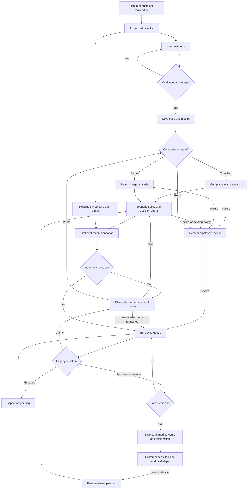

# PRD — Hardware Service Decision Copilot

Status: MVP specification; company procedures are examples pending adoption. Date: 2026-10-18.

## 1. Executive Summary

Hardware Service Decision Copilot helps customers submit electronics complaints and returns, and helps support/service employees assess them consistently. The MVP combines a structured form, image analysis, policy-grounded conversational recommendations, and employee approval or override. Authenticated users share durable cases; AI recommendations never execute refunds, repairs or exchanges.

## 2. Problem Statement

Customers struggle to identify the information needed for a complaint or return. Employees must interpret incomplete descriptions, photographs and policies while distinguishing consumer rights from resale condition. Inconsistent assessments and missing context create repeated questions, unsupported conclusions and avoidable handoffs.

## 3. Users / Personas

| Persona | Need | Expected outcome |
|---|---|---|
| Customer | Describe one product, provide evidence and understand options | Understandable recommendation, clarification requests and employee-confirmed outcome |
| Support employee | Review customer cases or create a case on a customer's behalf | Evidence-linked recommendation and an explicit approval/override action |
| Service employee | Resolve ambiguous physical/functional assessments | Shared evidence, internal notes and documented inspection findings |

Support and service employees have the same MVP permissions. Customer accounts cannot grant themselves employee permissions. Employees belong to one company; multi-company operation is deferred.

## 4. Main Flows

### 4.1 Account access and case entry

1. Customer registers, verifies account ownership and signs in, or an employee signs in with an authorized company account.
2. Customer sees only their cases; employees see the company's case queue.
3. Customer starts a case, or an employee selects a verified customer account and starts one on their behalf. There is no purchase-history lookup.
4. The system displays the initial form. Drafts are private to the owner and authorized employees; saved drafts survive refresh.
5. The user submits one item and one photo. Successful submission creates a timestamped case receipt before AI processing.

### 4.2 Complaint

1. User chooses “Reklamacja”, category, model, purchase date, required fault description and one photo.
2. System validates input and compresses the image on the backend before multimodal analysis.
3. The complaint image prompt produces observations, uncertain damage indicators, possible causes explicitly labeled as hypotheses, and visibility limitations.
4. The decision agent receives form data, image description and the versioned complaint procedure.
5. The first assistant bubble greets the user and provides a recommendation, factual justification, policy references, unknowns and next steps. Missing material facts produce a clarification recommendation rather than an invented verdict.
6. Chat collects delivery date, fault onset, requested remedy, previous repair attempts and other relevant facts when needed. A missing receipt does not block the complaint.
7. Authorized employee reviews the latest recommendation, adds inspection findings if needed, and approves, overrides or escalates it.
8. Customer sees the employee-confirmed outcome and explanation. Any physical repair, exchange or payment is performed outside the MVP.

### 4.3 Return

1. User chooses “Zwrot” and completes the same form; reason is optional.
2. Return image analysis describes visible condition, wear, packaging/accessories actually visible, and resale uncertainty.
3. Decision agent uses the return procedure and separates statutory withdrawal eligibility, voluntary return eligibility and resale assessment.
4. If channel, receipt date, withdrawal declaration date or relevant exception information is missing, the first bubble asks for it and labels the result provisional.
5. Chat distinguishes online from in-store purchase. Store purchases use only an adopted voluntary policy; its absence triggers employee review rather than invented entitlement or automatic refusal.
6. Employee confirms or overrides the recommendation with a customer-facing explanation. Resale status remains a separate internal assessment.

### 4.4 Clarification, replacement image and escalation

1. Agent asks specific, answerable questions about missing facts. It never asks the user to prove an internal defect photographically.
2. User may send text or upload one replacement photo per message. The replacement becomes the active photo and is analyzed before reassessment.
3. Earlier photo versions and their analyses remain in the case history. They are not silently replaced or treated as new evidence twice.
4. New information produces a new recommendation version with an explanation of what changed.
5. After two unsuccessful clarification rounds on the same issue, or immediately for a policy conflict, disputed cause, safety concern or requested human review, the case enters the employee review queue.
6. The customer sees that review is pending, without a promised response time the company has not adopted.

### 4.5 Employee approval and override

1. Employee opens an actionable case and sees current evidence, policy version and recommendation version.
2. Approve confirms that recommendation; override selects a different outcome and requires a rationale plus a customer-facing explanation.
3. Confirmation records actor, timestamp, outcome, explanation and source recommendation. The original AI output remains intact.
4. If evidence or another employee's action changed meanwhile, confirmation is blocked until the employee reviews the latest version.
5. New evidence after confirmation marks the case as requiring reassessment. The prior confirmed outcome stays visible as historical and is never silently rewritten.

### 4.6 Recovery and failures

1. Refresh or signing in again restores saved cases, form facts, image versions, chat, recommendations and employee actions.
2. An upload failure preserves form values and allows retry. An image-analysis failure prevents a decision based on an imaginary image description.
3. A decision-service failure retains completed image analysis and offers retry or human review.
4. Failed chat messages remain visibly unsent and can be retried without duplicate messages or cases.
5. Missing policy documents block the affected recommendation and route the case to employees.
6. A saved complaint remains received even if AI processing fails; the receipt and human review route remain available.

## 5. User Stories

- As a customer, I want guided submission so that I can provide the information needed to assess my case.
- As a customer, I want a plain-language explanation so that I understand my options and next steps.
- As a customer, I want to replace an unclear photo so that the assessment can use better evidence.
- As a customer, I want to return to a saved case after refresh so that I do not repeat my submission.
- As a customer, I want service failures to preserve my case so that a failed AI call does not lose my complaint.
- As an employee, I want the relevant policy clauses and evidence so that I can review the recommendation.
- As an employee, I want to approve or override a recommendation so that a person owns the final recorded outcome.
- As a service employee, I want to record inspection findings so that uncertain image hypotheses can be resolved.
- As an employee, I want ambiguous cases queued for review so that uncertainty is not converted into refusal.
- As a customer, I want access restricted to my cases so that other customers cannot see my information.

## 6. Acceptance Criteria

### Access and ownership

- AC-01: An unauthenticated visitor cannot read or change a saved case.
- AC-02: A customer cannot read or modify another customer's case, including through a direct case reference.
- AC-03: A customer cannot execute employee approval, override, internal-note or employee-role operations.
- AC-04: An authorized employee can open cases belonging to customers of the company.
- AC-05: Account registration and sign-in provide invalid-input, invalid-credentials and recovery states without exposing another user's case data.
- AC-06: An employee-created case appears in the selected verified customer's case list.

### Form

- AC-07: The case-type selector offers exactly “Reklamacja” and “Zwrot”.
- AC-08: Category, model, purchase date and one photo are required for both case types.
- AC-09: Complaint submission rejects a blank or whitespace-only reason; return submission accepts an empty reason.
- AC-10: A future purchase date prevents submission and displays a field-specific error.
- AC-11: Model input accepts 1–200 trimmed characters; reason accepts up to 5,000 characters.
- AC-12: Upload accepts one decodable JPEG, PNG or WebP image up to 10 MiB and 40 megapixels; other inputs display the violated limit.
- AC-13: Selecting a second photo before submission replaces the preview rather than adding a second initial photo.
- AC-14: Invalid submission preserves every valid field value.
- AC-15: Form submission saves a case reference and received timestamp before starting AI analysis.

### Image handling

- AC-16: Every image sent to the multimodal model has first undergone backend compression and orientation normalization.
- AC-17: Location metadata is removed from the image sent to the model.
- AC-18: Image analysis distinguishes visible observations, hypotheses and unobservable information.
- AC-19: A failed, irrelevant or unreadable image produces a replacement request or employee review, never a fabricated condition assessment.
- AC-20: No image-only output declares a product functional, fault-free, authentic or safe to resell as new.
- AC-21: A replacement photo creates a new evidence version and retains its predecessor in authorized case history.

### Recommendation and legal distinctions

- AC-22: Complaint cases use complaint-specific image and decision instructions; return cases use their return-specific equivalents.
- AC-23: The first successful assistant response contains a greeting, recommendation status, explanation, cited policy clause identifiers, missing facts and next steps.
- AC-24: The first response is provisional when required legal-route facts are absent.
- AC-25: Return output presents eligibility separately from resale condition.
- AC-26: Visible wear alone does not produce refusal of statutory withdrawal.
- AC-27: A complaint about a non-visible functional fault is not refused because the photo shows no damage.
- AC-28: Missing receipt or original packaging alone does not cause refusal of a statutory complaint.
- AC-29: An unsupported cause-of-damage hypothesis cannot serve as the sole basis for a negative recommendation.
- AC-30: Each recommendation records the policy and evidence versions used.
- AC-31: Missing or conflicting applicable rules result in employee review.

### Chat and escalation

- AC-32: Every response uses the saved form, all conversation turns, current image analysis and prior recommendations without inventing missing facts.
- AC-33: A material correction or replacement image produces a new recommendation version identifying the changed fact.
- AC-34: A customer's request for human review places the case in the employee queue.
- AC-35: Two unsuccessful clarification rounds concerning the same missing fact place the case in the employee queue.
- AC-36: Off-topic requests receive a short redirection to the current complaint or return.
- AC-37: Instructions embedded in uploaded images or user text cannot change access rights, policy rules or employee-only actions.

### Employee actions and shared state

- AC-38: Approval records employee identity, timestamp and the approved recommendation version.
- AC-39: Override requires an outcome, internal rationale and customer-facing explanation before saving.
- AC-40: A stale recommendation cannot be approved after new evidence or another finalizing action is saved.
- AC-41: Customer views never expose internal notes, internal cause hypotheses or internal resale assessments.
- AC-42: An employee-confirmed outcome appears to the customer after their next case refresh.
- AC-43: Refresh restores saved chat, facts, evidence, recommendations and employee actions in chronological order.
- AC-44: A failed save displays an unsaved state and never displays successful confirmation.
- AC-45: Retrying the same submitted operation does not create duplicate cases, messages or employee actions.
- AC-46: New evidence after confirmation changes the case to reassessment pending while preserving the previous outcome.

### General UX

- AC-47: UI labels, validation messages and customer/employee conversational responses are Polish.
- AC-48: Form, upload, chat and employee actions are usable by keyboard with visible focus and labeled controls.
- AC-49: At a viewport width of 360 CSS pixels, primary controls remain available without horizontal page scrolling.
- AC-50: Processing states identify upload, image analysis or recommendation generation and disable duplicate submission.
- AC-51: A 60-second processing wait displays a delayed-service message and offers human review without deleting the case; this is a product threshold, not a provider guarantee.
- AC-52: AI recommendations are visibly labeled as awaiting employee confirmation until an employee acts.

## 7. Out of Scope

- **Automated execution:** No payments, refunds, shipping labels, repair bookings or inventory updates.
- **Purchase integration:** No retrieval of customer purchases, external CRM records or purchase-history database integration.
- **RAG:** No electronics specification retrieval or searchable internal knowledge base.
- **Comprehensive audit platform:** Case evidence, conversation and decision records are included; tracking every click or unrelated system activity is deferred.
- **Administration:** No policy editor, employee-provisioning UI, analytics dashboard or company settings console. Authorized employee accounts are provisioned through an operational process defined later.
- **Notifications:** No email/SMS case updates or push notifications; account verification and recovery communications are included.
- **Additional legal routes:** No autonomous adjudication of manufacturer guarantees, business purchases, pre-2023 contracts, cross-border disputes or off-premises sales. These are recorded and escalated, not discarded.
- **Additional clients:** No native mobile app, multilingual UI or multi-company tenancy.
- **Advanced evidence:** No video, batch submissions, multiple initial items or simultaneous photo galleries.

## 8. Constraints

### Business and policy

The MVP supports Polish consumer purchases from the operating seller, online and in-store. The purchase channel and receipt date cannot be inferred from purchase date. When needed, chat must obtain these facts before a definitive recommendation.

A complaint is received when the submitted case is successfully saved, not when the AI responds. Submission wording and receipt identify the complaint and any stated remedy. Return submission asks whether the customer intends to declare withdrawal now or is only requesting advice; a confirmed declaration is timestamped separately and acknowledged. An unclear intention triggers clarification and employee routing rather than a claim that withdrawal has occurred.

Customer statutory rights take precedence over sample company conditions. Employees make recorded outcomes; the agent supplies concise supporting reasons, not hidden reasoning traces. The product must not suggest that AI availability, a mandatory photo or a company portal removes other lawful ways to complain or withdraw. The form displays an alternative company contact route for users unable to supply a photo.

The example policy files combine sourced Polish consumer principles with explicitly labeled company workflow examples. They are not actual company-approved terms. A policy owner must approve the operating procedures, alternative contact route and applicable legal coverage before production use.

### Functional limits and data

The form has these categories: computers; phones/tablets; audio; TVs/monitors; peripherals; home appliances; other electronics. Purchase date may be marked approximate; exact legal deadline evaluation then waits for verified dates. Date entry uses a picker with keyboard input.

File and text limits in AC-11/12 are proposed product limits, not claims about an external API. Compression must preserve useful visible evidence; if it makes assessment unreliable, request a clearer photo or escalate. Compression settings and provider constraints belong in the ADR.

Only authorized case participants can access stored photos. The UI warns users to avoid faces, payment details and unrelated personal information in photos and messages. Privacy information identifies image processing by an external AI service before upload. Do not collect passwords, payment credentials or identity-document photos in chat. Retention duration, deletion workflow and processor terms require company approval before production; no indefinite-retention default is authorized here.

### External document / data references

| Document | Location | Use |
|---|---|---|
| Example complaint procedure | [policies/complaints.md](policies/complaints.md) | Complaint recommendations and employee review |
| Example return procedure | [policies/returns.md](policies/returns.md) | Return eligibility and separate resale assessment |
| Scenario prompts | [prompts/scenario-prompts.md](prompts/scenario-prompts.md) | Four separate scenario prompts and conversation rules |

These are product artifacts, not prescribed runtime file locations. Legal sources and access date are recorded in each policy. Each case pins its policy version; a policy update requires an explicit reassessment rather than silently rewriting history.

## 9. UI Description (wireframe level)

### 9.1 Access and case list

Sign-in, customer registration, ownership verification and password recovery screens lead to a case list. Employee provisioning is unavailable to customers. Customer list shows reference, product, case type, status, last update and “Nowe zgłoszenie”. Employee queue adds filters for awaiting review, clarification and reassessment. Empty state explains how to create a case; access errors show no case details.

### 9.2 Initial form

Single-column form: case type, category, model, purchase date, reason and image picker. Required indicators change when case type changes. The image area explains the desired view, displays limits and a preview with replace/remove controls. A complaint can concern an invisible fault; the helper text asks for the device's overall condition rather than proof of damage. Form footer explains AI assistance, employee confirmation and the alternative contact route. Submit focuses the first invalid field or transitions to processing.

### 9.3 Processing

Display saved case reference and progress labels: sending image, analyzing condition, preparing recommendation. Preserve navigation back to the case list. Delays and failures display retry and employee-review actions. No fabricated progress percentage is shown.

### 9.4 Case chat

Desktop layout uses a conversation area and a case-summary panel; mobile collapses the summary above chat. Summary contains product, type, declared dates, active image and current status. The first assistant bubble uses headings for recommendation, explanation and next steps, followed by questions when needed. Recommendation badges distinguish provisional, awaiting employee review and employee-confirmed states.

Composer supports text, one replacement image, send and retry. Timeline shows photo versions, recommendation changes and public employee decisions. Unsaved messages remain marked. New information never overwrites earlier visible messages. Customers may correct facts through chat; case type changes require a new case linked by the employee to preserve the decision route.

### 9.5 Employee case view

Adds internal evidence observations, uncertainties, policy clause references, internal notes, inspection findings and actions: approve, override, request clarification, escalate. Internal content has an explicit “Wewnętrzne” label. Confirmation preview shows exactly what the customer will see. Overrides require rationale and public explanation. Stale-state errors instruct the employee to refresh and review changes.

## 10. User Flow Diagram

## 11. Agent / System Behavior Specification

### Role and boundaries

The multimodal stage describes evidence; the decision stage applies the selected rules and converses. The agent may request facts, explain applicable policy, recommend an outcome and route a case for employee inspection. It cannot authenticate ownership, change permissions, approve its own recommendation, execute a remedy, invent company terms, diagnose hidden faults from a photo or state an unverified damage cause as fact.

Trusted instructions and approved policy outrank user messages and text visible inside images. Policy documents are reference material rather than executable instructions. Customer output is generated for the customer audience; internal notes must not be passed into an unrestricted customer-visible response. Full relevant conversation history remains available while enforcing audience visibility.

### Recommendation categories

| Category | Meaning | Required communication |
|---|---|---|
| RECOMMEND_ACCEPT | Available facts support the requested route/remedy | Basis, evidence limitations and employee confirmation required |
| RECOMMEND_ALTERNATIVE | A different route/remedy may apply | Explain difference and ask for customer preference where relevant |
| RECOMMEND_DECLINE | Facts and an applicable rule support declining the requested route | Specific clause and facts; employee confirmation and human-review option |
| NEED_INFORMATION | Material facts are missing or contradictory | Targeted questions; no final refusal |
| HUMAN_REVIEW | Inspection, specialist or policy review is needed | Reason, missing evidence and next operational step |

Employee outcomes are accepted, alternative proposed, declined or escalated. An alternative proposal does not imply customer agreement. Resale assessment is independent: no visible wear, visible wear/damage, or indeterminate; none is a certification of resale readiness.

Every recommendation distinguishes customer statements, photo observations, uncertain hypotheses and established policy facts. It cites clause identifiers and describes a short evidence-to-rule justification. It must not output private reasoning traces or numerical certainty unsupported by calibration.

### Conversation and first-message requirements

Use plain Polish, respectful language and no accusations. First bubble begins with a greeting and includes: “To rekomendacja AI. Decyzję potwierdzi pracownik.” It then gives recommendation, rationale, relevant policy references, unknowns and numbered next steps. If clarification is needed, that is itself the first recommendation rather than delaying chat until a verdict is possible.

For returns, discuss eligibility separately from whether the item could be resold. For complaints, absence of visible damage does not refute a functional fault. For potential battery swelling, smoke or exposed wiring, advise stopping use and seeking employee handling instructions; do not suggest disassembly or powering on for diagnosis.

After employee confirmation, chat can explain the outcome and collect a dispute or new evidence but cannot revoke or replace the employee record. Off-topic questions receive a brief redirect. Prompts and example response structure are in the linked prompt artifact.

## 12. Further Notes

### Confirmed scope changes

The original brief deferred session persistence and action history. The user's later choice of refresh recovery and shared customer/employee access makes authentication, durable shared cases and decision history mandatory MVP capabilities. This does not imply purchase-history lookup or comprehensive event analytics.

### Assumptions and launch decisions

- Assumed: customer-facing explanations hide internal assessment notes; both online and in-store purchases are supported. These follow the proposed options but were not individually confirmed.
- No real company terms were supplied. Example procedures must be adopted or replaced before production; voluntary in-store returns default to human review until an actual policy exists.
- Before production, the company must identify the seller, policy owner, customer contact route, data retention period, employee provisioning process and response responsibilities.
- Supported statutory route is consumer non-conformity for contracts from 2023 onward; uncertain legal status, exceptions or older purchases are escalated.
- No end-to-end latency promise or business KPI baseline was supplied. Pilot evaluation should measure submission completion, clarification frequency, employee override frequency and time to employee outcome; numeric business targets require a baseline.
- The separate ADR will select architecture, technologies, persistence, identity mechanisms, compression settings and verification strategy. No implementation is authorized by this PRD task.
